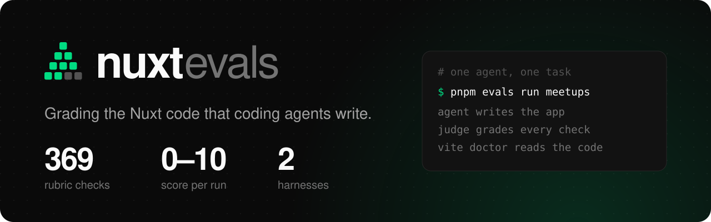

<h1>
  
</h1>

[](https://nuxt-evals.onmax.me)
[](https://nuxt-evals.onmax.me/timeline)
[](https://nuxt.com)

Do the Nuxt MCP, the core Nuxt skills and the nuxt-skills plugin make coding agents write better Nuxt 5 / Nitro v3 / h3 v2 code? This repo runs agents on tasks, grades what they wrote, and publishes the results at [nuxt-evals.onmax.me](https://nuxt-evals.onmax.me).

**Ended on 2026-11-24.** Skills didn't make the apps better: Opus 5.5 and GPT-6.2 Sol scored lower with them in three of four project pairs, and higher in one by 5 points, within run-to-run noise. No more runs. The results, sessions and methodology stay online; the [timeline](https://nuxt-evals.onmax.me/timeline) tells how it went.

[Results](https://nuxt-evals.onmax.me) · [Timeline](https://nuxt-evals.onmax.me/timeline) · [Methodology](https://nuxt-evals.onmax.me/methodology) · [Run it yourself](https://nuxt-evals.onmax.me/run-it) · [How a run flows](#how-a-run-flows) · [Plan](research/plan-v2.md)

An independent project by [@onmax](https://github.com/onmax).

Status: **pilot.** Two projects, plus five small ViteHub UI tasks graded by browser probes (`tasks/vitehub-ui`), not run yet. Meal planner (`tasks/meal-planner`) is a Vue 3 + Vue Router 5 app with no backend, graded by the same judge on its own rubric; the agent starts with only the recipe data. The first project is Meetups (`tasks/meetups`): the agent starts in an empty folder with a short, vague prompt that asks for Nuxt nightly and ViteHub, and an Opus 5.5 judge grades the app against a 219-check rubric (`RUBRIC.md`), next to a reference app built with Nuxt 5 and ViteHub (`reference/`). Each run scores 0 to 10: 65% general sections, 25% the six ViteHub sections, 10% [Vite Doctor](https://vite-doctor.onmax.me). A separate vibe pass (`VIBE.md`) scores the design and is shown beside it. The design is in [research/plan-v2.md](research/plan-v2.md); this round's changes and numbers are in [research/findings-v5.md](research/findings-v5.md).

## How a run flows

Agents don't run on the server. They run on your machine (or a runner), and the site imports what they recorded.

1. `pnpm evals run <project>` copies `tasks/<project>/fixture` (or nothing, for a project without one) into a fresh Git working copy in a temp folder, with an empty HOME elsewhere, and runs the agent's own CLI there (`codex exec` or `claude -p`), through CLIProxy or the provider's API key.
2. It keeps the agent's **native session file**, the diff and the files, grades the probes, audits what the agent was offered, prices the tokens from models.dev list prices, and writes an Opus 5.5 summary. Everything lands in `cli/.data/runs/<id>/`, with ids like `20261111-0900-meetups-opus-a2` (the agent's name from the model set, or its model id).
   Rubric projects (Meetups) are graded by the judge instead of probes (`cli/lib/judge.ts`). It runs Claude Code with Opus 5.5, through CLIProxy or an Anthropic API key (`cli/lib/providers.ts`), with an empty Claude config. One session installs, builds and starts the app as its README says and grades P1 and P3; the CLI then starts the production server once; grading sessions, three at a time, grade the other sections against the running app and the code, with evidence for every check. The CLI turns the outcomes into scores from 0 to 10 with the rubric's rules (`site/shared/rubric.ts`), so the judge never picks a score. A grading session that ends without a grade (it crashed or timed out) stops the grade, and nothing is written; `pnpm --filter cli test` checks that. The grade goes into `run.json` as `rubric`, and `score` becomes the headline over 10. `pnpm evals judge reference` grades the reference app the same way, into `tasks/meetups/reference-grade.json`. The judge is blind: the reference is graded from a folder with a neutral name, with a session log that records no session, so nothing tells it which app it has. After the setup session, the CLI runs Vite Doctor (`cli/lib/doctor.ts`, JSON report) on the installed app and scores it against the rules the reference app fires; the build it runs is `vite-doctor` in `cli/package.json`, or `VITE_DOCTOR_CLI`. A vibe session reads the code against `tasks/meetups/VIBE.md` and the reference app. After a grade, an explain step (`cli/lib/explain.ts`) reads the code again, without running it, and adds to each failed check the lines it is about and a fix; for the reference it adds the lines behind each pass. The site shows them when you open a check. `pnpm evals explain` runs that step alone, for a grade that has none; it never changes an outcome or a score.
3. `pnpm evals push <id|all>` sends a run to the site. It refuses a run whose audit failed (an outside read, a missing skill or MCP) and prints why; once you have read the session and the read is harmless, push it with `--accept-audit`. `pnpm evals base <project>` sends the starting app, the prompt and the probes, which `/projects/<project>` shows.
4. `site/` (Nuxt 5 on Cloudflare Workers) keeps the row in D1, the raw session in Blob, the summary in ViteHub Content, and the working copy in the project's ViteHub Workspace (`server/workspaces/meetups.ts`): ref `main` is the starting app, and each run commits its files to a ref named after the run. A run records the `main` revision it started from, so a newer starting app does not change older diffs. It imports the session into its Agent journal with `importAgentSession()` from `@vite-hub/agent/sessions` (a pnpm patch). Every session belongs to one Agent, `coding-agent`; the harness (Codex or Claude Code), model and setup are fields of the session. The public Console shows the prompt, notes, thinking, every command with its output, file changes as diffs, the skills the agent had, usage and cost, and the session's Workspace revision. The run page and the project page have a **Preview** tab: it runs that working copy in the reader's browser with `@vite-hub/web-container`. `evals push` and `evals base` build the app's `node_modules` as a WebContainer installs them (`cli/lib/preview.ts`) and upload that snapshot to Blob (`previews/`); the Preview mounts it instead of running `npm install`, which fails from the deployed origin, applies ViteHub's migrations inside the dev server, and starts `nuxt dev`. Without a snapshot it falls back to `npm install`. Pass `--no-preview` to skip the snapshot. Those two pages send `Cross-Origin-Opener-Policy` and `Cross-Origin-Embedder-Policy: credentialless` for it.

## Run it

[Run it yourself](https://nuxt-evals.onmax.me/run-it) walks through a first run: keys, agent, setup, score. The commands:

```sh
pnpm install
cp cli/.env.example cli/.env          # ANTHROPIC_API_KEY and OPENAI_API_KEY, or CLIPROXY_URL and CLIPROXY_API_KEY
pnpm evals run meetups --agent opus --repeat 3 --parallel 3 --no-judge   # three Opus sessions at once
pnpm evals run meetups --agent sol                  # agents: opus (medium), fable (high), sol (xhigh)
pnpm evals judge <id|all>                           # grade saved Meetups runs again (one app at a time)
pnpm evals judge reference                          # grade the reference app (the yardstick); --project meal-planner for the other project
pnpm evals explain <id|all|reference>               # add fixes and cited lines to a grade that has none
pnpm evals list
pnpm evals tasks                                    # every project: probes, target, and whether it can run yet
pnpm evals push all
pnpm evals rescore <id|all|reference>               # new scores from stored outcomes, without the judge
pnpm evals base meetups                             # prompt, rubric, reference app and its grade for /projects/meetups
pnpm evals reset --yes                              # deletes every run on SITE_URL
```

Other flags: `--harness`, `--model`, `--reasoning`, `--no-summary`, `--no-judge`, `--no-explain` (skip the explain step after a grade). `--agent` picks a model and effort from the model set in `cli/lib/agents.ts`; `--model` alone takes that model's effort from it. Judge one app at a time: each grade runs three judge sessions at once (`JUDGE_PARALLEL`). `pnpm evals summarize <id|all>` rewrites summaries.

Setups (`--setup`, default A): A is bare. B is the [Nuxt MCP](https://nuxt.com/docs/guide/ai/mcp) and the hosted core skill from nuxt-skill.onmax.me. C is the Nuxt MCP and a stack set of [onmax/nuxt-skills](https://github.com/onmax/nuxt-skills) installed as separate skills (`nuxt`, `nitro`, `vue`, `vue-best-practices`, `vue-router-best-practices`, `pinia`, `nuxt-ui`, `vueuse-functions`, `vite`). V is the three core Vue skills from the same repository and no MCP, for apps without Nuxt. C and V snapshot one pinned nuxt-skills commit (`skillsCommit` in `cli/lib/setups.ts`); the snapshots live in `setups/<setup>/skills` and `setups/sources.json` records their source, commit and hash. `pnpm evals skills` refreshes B, C and V. CS and VS are C and V with one line added at the end of the prompt, `USE ALL THE SKILLS.` (`skillsPrompt` in `cli/lib/setups.ts`): C and V measure skills the agent chooses to open, CS and VS measure them when it is told to.

Every run gets the same Playwright Chromium through `PLAYWRIGHT_BROWSERS_PATH`, in `~/.cache/nuxt-evals/ms-playwright` (`cli/lib/browsers.ts`). `evals run` installs it before the agents start; Codex may write to it, and the audit doesn't count reads there as looks outside the working copy.

Site locally: `pnpm dev:site` (http://127.0.0.1:4791). Apply the local migrations once with `pnpm --filter site exec vitehub database migrate`; push to it with `SITE_URL=http://localhost:4791`.

## Deploy

A push to `main` deploys `site/` through Cloudflare Workers Builds, connected to this repository on the `nuxt-evals` Worker (Settings > Builds). GitHub Actions does not deploy. Build command `pnpm --filter site build`, deploy command `pnpm --filter site release` (D1 migrations, then `wrangler deploy --config .output/server/wrangler.json`), build variables `NODE_VERSION=24` and `PNPM_VERSION=11.18.0`. The Worker needs these secrets:

- `NUXT_INGEST_TOKEN`; the CLI sends the same value as `INGEST_TOKEN`.
- `VITEHUB_SECRET`, which signs the Auth sessions.
- `VITEHUB_CONSOLE_KEY_CONSOLE_<id>`, the public key of the app's link in https://console.vitehub.dev. The Console signs each call with the private key it keeps and shows this line when you link the app; set it with `wrangler secret put`. Unlinking means removing it.

## Sign-in and the Console

The site has one account, Maxi's, at `/sign-in` (Bitwarden item "nuxt-evals.onmax.me", with a passkey). Sign-up closes once it exists. The account is who the Content editor lets in. Comments are Hosted Comments in the Console: open any page with `?vitehub`, choose Comments and sign in to ViteHub. The threads live in the Console's database, not the site's. The Console is https://console.vitehub.dev, linked with the key above; the app has no Console of its own to sign in to.

The Site access upgrade signs out legacy guests whose sessions would no longer appear in the Console. It leaves user accounts intact and doesn't affect the owner's or tracked guests' sessions. Issue replacement links after deploy. The migration runs before the Worker deploy and blocks guest session creation without a Site access ownership record, so the old Worker can't issue untracked sessions in that gap.

## Layout

| Path | What |
| --- | --- |
| `research/` | Plans, research reports and findings. Start here. |
| `tasks/` | Task prompts, fixtures and probes. |
| `cli/` | Runs agent CLIs, grades and stores runs, pushes them. Node only. |
| `site/` | Results site and public Console on Cloudflare. |
| `patches/` | pnpm patches on ViteHub, each written up for upstream (none today). |
