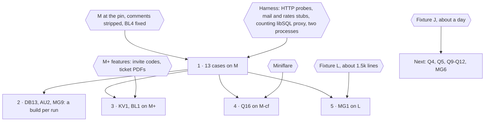

## The answer

Build the first 20 fix evals in five steps, starting with 13 cases that need only the Meetups reference at pin `1e807fc9`, comments stripped, plus a test harness. The reference already holds the best fix for most of them, so each plant is a few inverted lines and its hidden tests come from the reference's own probes.

> [!IMPORTANT]
> **Your call:** take my recommendation on all seven open questions in the table below?

> [!WARNING]
> Most ViteHub fixes the corpus cites landed after the pin. Each case says which side of the pin it assumes, and moving the pin means regrading the reference first.

## Decisions

Numbers are the open questions in `corpus-v0.md` section 8; these seven concern fix evals.

| # | Question | Recommend |
| --- | --- | --- |
| 1 | Keep one pin for wave 1 and rebase in wave 2? | :badge[yes]{color="success"} MG9 is the bridge |
| 2 | Fix M's native bugs in the base and plant them back per case? | :badge[yes]{color="success"} BL4 now; Q16 stays as its own case |
| 3 | Web access on for A, with a transcript audit? | :badge[yes]{color="success"} fail runs that fetch the reference, Drop or a fix commit |
| 6 | Cloudflare cases: is vite dev with `preset: 'cloudflare'` enough? | vite dev for Q6, DB4; Miniflare for Q16, MG12 |
| 7 | Change tasks now, and do controls count in the headline? | own track after the 20; CH9, CH10 scored apart |
| 9 | You label novel fixes and they join the corpus as rows? | :badge[yes]{color="success"} |
| 10 | Contracts: rare duplicate mail, every RSVP mailed, MG15 continuity? | duplicate OK; no outbox; ids survive, reset allowed |

::accordion
:::accordion-item{label="1 · Pin"}
The reference is graded at `1e807fc9`. Moving it means regrading it and first refreshing `runQueue` and Blob serve access. MG9 measures the bump itself, so it doesn't have to happen before wave 1.
:::

:::accordion-item{label="2 · M's native bugs"}
M buffers the whole upload before the size check (BL4). An oracle with that weakness grades a correct fix against a weak base, so fix it in the base and plant it back for BL4. M's `idempotencyKey` (Q16) fails only on Cloudflare, where it is the case itself; on Node M is correct, so leave it. The `site/` token compare (HB2) belongs to Type B.
:::

:::accordion-item{label="3 · Web access"}
A fix eval should reward finding the right primitive, and that needs the vitehub.dev docs. The audit covers the leak routes: the reference (the site's Workspace), `vite-hub/drop`, and the fix commit.
:::

:::accordion-item{label="6 · Cloudflare checks"}
vite dev with the Cloudflare preset applies D1's parameter limit and Queue payload limit (`59b44644ad`, `f6467591bc`), so Q6 and DB4 reproduce there. Q16 and MG12 need the provider runtime. Miniflare costs about 1 GB per run, so run those two one at a time.
:::

:::accordion-item{label="7 · Change tasks"}
Change tasks reuse M's hidden tests and need no plants, so they are cheap, but they measure feature work, not diagnosis. Corpus order: CH4, CH10, CH2, CH6, CH7. A "no change" control rewards doing nothing, which would lift a headline built on fixes, so report CH9 and CH10 apart.
:::

:::accordion-item{label="9 · Novel fixes"}
The judge runs twice. On disagreement or "novel" you label the diff, it joins the case as a ranked row, and the novel rate per case tells which cases still need work.
:::

:::accordion-item{label="10 · Contracts"}
No database flag closes the "provider accepted, answer lost" window without a provider key; M's claim and release narrow it to that window (Q2), so a rare duplicate is the honest contract. An outbox is acceptable in Q13 only if every committed RSVP must get mail; M logs a failed enqueue. MG15's report says existing people must still get in: user ids must survive, and a reset path with stated impact meets that, below a dual-read migration.
:::
::

## What a fix eval is

Each run gives the agent one fixture with one plant and a vague user report, and grades the fix against ranked solutions.

| Part | What |
| --- | --- |
| Fixture | an app from the list below, comments stripped, one fresh commit |
| Plant | one bug, perf problem, security hole, or legacy code to migrate |
| Report | a user's words, never the cause |
| Tools | no skills; web on (question 3) |
| Gate | hidden fail-to-pass tests, the visible suite, a build |
| Grade | the diff matched to the case's ranked fixes, plus root cause and footprint |

## The first 20, in build order

Boxes are build steps; hexagons are work that has to land first. Fixture J blocks none of the 20, but it blocks the next wave.

Seats counts how many of the four council seats picked the case.

| Step | Case | Fixture | Seats | Difficulty |
| --- | --- | --- | --: | --: |
| 1 | DB1 Seats left goes negative | M | 3 | 3 |
| 1 | KV5 A cache shows one user's data to another | M | 3 | 3 |
| 1 | Q1 A failed send is logged and the job succeeds | M | 2 | 2 |
| 1 | Q2 A retried job sends the email again | M | 2 | 3 |
| 1 | AU1 Signed-in pages read the session once per component | M | 2 | 3 |
| 1 | AU3 A global middleware reads the session on every request | M | 2 | 3 |
| 1 | DB2 One seat-count query per event | M | 2 | 2 |
| 1 | DB3 Independent reads wait in line | M, DR | 2 | 2 |
| 1 | KV2 The paid upstream is called per request | M | 2 | 2 |
| 1 | AU7 Signed in is treated as owner | M | 2 | 1 |
| 1 | KV6 A cached handler ignores the query | M | 1 | 3 |
| 1 | BL2 An uploaded SVG runs script | M | 1 | 2 |
| 1 | Q3 Reminders arrive twice, or never | M | 1 | 3 |
| 2 | DB13 The list ships every column | M | 2 | 2 |
| 2 | AU2 Better Auth's client in every page's entry chunk | M or V | 2 | 3 |
| 2 | MG9 Bump ViteHub across breaking renames | M | 1 | 3 |
| 3 | KV1 A single-use code works twice | M+ | 2 | 2 |
| 3 | BL1 The served store publishes private files | M+ | 2 | 3 |
| 4 | Q16 `idempotencyKey` refused on Cloudflare | M-cf | 1 | 4 |
| 5 | MG1 Move a NuxtHub app to ViteHub | L | 3 | 4 |

After the 20, the corpus queues SEC2, BL4, DB4, RL1, AU5, Q13, Q7, Q8, SSR1, SSR2, SSR3, KV3, DB10, DB11, Q15, PF3 and PF1.

## Each of the first 20

Every item has the same parts: why it goes first, the report, the plant, the root cause, the ranked fixes, the main trap, the check, and the evidence. "M" in a fix means the reference already does it.

::accordion
:::accordion-item{label="1 · DB1 Seats left goes negative"}
- **Why first:** Maxi's example. The two-process test separates real fixes from mutexes.
- **Report:** "Seats left goes negative when two people RSVP at once. 14 people came to a 12-seat event."
- **Plant:** `rsvp.post.ts:18-27`: the one conditional insert becomes a `seatsLeft` read, a 409 check, then an insert; the `max(…, 0)` goes. 8-12 lines.
- **Root cause:** Check, then insert, across an `await`. Two requests both read a free seat, then both insert.

| Rank | Fix | Why |
| --- | --- | --- |
| :badge[best]{color="success"} | one `INSERT … SELECT … WHERE count < capacity … RETURNING` (M) | one atomic statement, works on D1 |
| :badge[acceptable]{color="neutral"} | counter column `UPDATE … WHERE taken < capacity RETURNING`, insert in `db.batch()` | needs a compensating decrement |
| :badge[acceptable]{color="neutral"} | `BEFORE INSERT` trigger with `RAISE(ABORT)` | Drop's fix `7093d7c0` |
| :badge[acceptable]{color="neutral"} | `BEGIN IMMEDIATE` or `db.transaction()` | not portable: fails on D1 |
| :badge[over-engineered]{color="warning"} | Queue with concurrency 1, Durable Object, KV lock | infrastructure for one statement |
| :badge[masks-symptom]{color="error"} | clamp the display, disable the button | the oversell stays |
| :badge[wrong]{color="error"} | in-memory mutex per event | passes only a one-process test |

- **Main trap:** a mutex, or `db.transaction` in an app bound to D1.
- **Verification:** 30 distinct users RSVP at once to 12 seats against two server processes on one database file: 12 rows, 18 × 409, `seatsLeft ≥ 0`, over 5 repeats.
- **Evidence:** real. Rubric B6 failed in 7/15 graded runs; Drop `7093d7c0`; joxi `9f1bd85`.
:::

:::accordion-item{label="1 · KV5 A cache shows one user's data to another"}
- **Why first:** A perf report that tempts a leak. The seats' first plant was wrong and had to be corrected.
- **Report:** "Sometimes I see an Edit button on events that aren't mine, and it says I'm going to events I never RSVP'd to."
- **Plant:** `[slug]/index.get.ts` wrapped in `defineCachedFunction` with `getKey: slug => slug` and `maxAge: 60`; the value carries `going` and `isOrganizer`. 6-15 lines.
- **Root cause:** The key covers the slug only, but the value depends on the user.

| Rank | Fix | Why |
| --- | --- | --- |
| :badge[best]{color="success"} | cache the public part by slug, add `going` and `isOrganizer` per request | shared work cached, personal work not |
| :badge[acceptable]{color="neutral"} | no cache, reads in `Promise.all` (M) | already fast |
| :badge[acceptable]{color="neutral"} | `userId` in `getKey` | correct, one entry per user per event |
| :badge[over-engineered]{color="warning"} | a client-side store as cache | moves the problem |
| :badge[masks-symptom]{color="error"} | `maxAge: 5` | a shorter leak |
| :badge[wrong]{color="error"} | `defineCachedHandler` with `varies: ['cookie']` | stores personal data per cookie |

- **Main trap:** removes the cache and keeps the leak in another helper; misses that `seatsLeft` is now stale.
- **Verification:** A loads the page, then B within 60 s: B's `isOrganizer` is false and `going` is B's, in HTML and payload. The public part hits the database at most once per slug per minute.
- **Evidence:** real class, synthetic plant. ViteHub `7ff101f2c7` (#3987, after the pin) fails the build when an Auth-guarded route is cached. A cached handler strips cookies in Nitro 3, so the seats' first plant gave 401, not a leak.
:::

:::accordion-item{label="1 · Q1 A failed send is logged and the job succeeds"}
- **Why first:** ViteHub's commonest nook. A 2-line plant, and its logged form is invisible to Doctor.
- **Report:** "Resend was down for ten minutes on Tuesday. Nobody who RSVPed then got a confirmation, and nothing retried."
- **Plant:** `mail.ts:63-68`: drop the claim release and `throw error`, keep the `console.error`. 2-6 lines. Variant: a bare `await email.send(…)`.
- **Root cause:** `email.send()` returns `[error, data]` and does not throw. The job resolves, the Queue acks it, and the sent-at claim stays set, so no retry sends.

| Rank | Fix | Why |
| --- | --- | --- |
| :badge[best]{color="success"} | release the claim and rethrow (M) | the Queue retries |
| :badge[acceptable]{color="neutral"} | mark sent only after a successful send | a crash between send and mark sends twice |
| :badge[over-engineered]{color="warning"} | an outbox swept by a Schedule; a Workflow step for one send | new machinery for one rethrow |
| :badge[masks-symptom]{color="error"} | `try/catch` plus a log; a `setTimeout` retry | nothing throws |
| :badge[wrong]{color="error"} | rethrow without releasing the claim | the retry finds the claim and returns |

- **Main trap:** a `try/catch` around a call that never throws.
- **Verification:** a stub that fails twice, then accepts: exactly 1 mail and `confirmation_sent_at` set. An always-failing stub: the job dies after 4 attempts and the column stays null. Running the job twice sends 1.
- **Evidence:** real. ViteHub `2ea9501659` (#2579, tuples), Doctor rules `49f1002aaa` (#3168); nuxt-evals `38f825d` added the check.
:::

:::accordion-item{label="1 · Q2 A retried job sends the email again"}
- **Why first:** Tests the `idempotencyKey` misconception, and it has many fixes to rank.
- **Report:** "Some attendees got the 'you're going' email two or three times."
- **Plant:** `mail.ts:27-30`: the conditional claim goes; the job sends first, then sets the column. The mail stub times out after accepting once. About 10 lines.
- **Root cause:** Delivery is at least once and the handler sends before it records. A lost provider answer, or a restart before the ack, sends again.

| Rank | Fix | Why |
| --- | --- | --- |
| :badge[best]{color="success"} | claim sent-at in one conditional `UPDATE … RETURNING` before the send, release on error (M) | a retry finds the claim |
| :badge[acceptable]{color="neutral"} | a unique `sent_emails(kind, rsvp_id)` row before the send | same idea, extra table |
| :badge[acceptable]{color="neutral"} | a provider key: `email.send({ idempotencyKey })` | Resend only; Cloudflare Email refuses it |
| :badge[over-engineered]{color="warning"} | a Workflow with a send step | steps repeat too |
| :badge[masks-symptom]{color="error"} | `maxAttempts: 1` | duplicates stop, mail is lost |
| :badge[wrong]{color="error"} | `idempotencyKey` on the enqueue only; a KV sent flag | dedupes pending jobs, not attempts; racy |

- **Main trap:** the enqueue `idempotencyKey`, which dedupes only pending or running jobs.
- **Verification:** the stub accepts, then times out: after the retry it holds exactly 1 mail per RSVP. Two parallel jobs for one RSVP send 1. Re-running a completed job sends nothing.
- **Evidence:** real class: babysitter `2208a8287`, `1a773f605` (a redelivery re-ran a paid pass). M's design is the best fix.
:::

:::accordion-item{label="1 · AU1 Signed-in pages read the session once per component"}
- **Why first:** The "Vue portal" class (see the section below) with a plain call count.
- **Report:** "The home page is fine logged out but takes seconds when I'm logged in. The network tab shows get-session three times."
- **Plant:** `useAuth()`'s `useState` and the `callOnce` plugin become `useMe()` = `useFetch('/api/me')`, called by the header and every `EventCard`. About 30 lines.
- **Root cause:** Each call site reads the session during SSR, each read hits the database, and the browser reads again on hydration because the payload doesn't carry it.

| Rank | Fix | Why |
| --- | --- | --- |
| :badge[best]{color="success"} | one session state per request: `useState` plus `callOnce` (M); `going` from the list API | one read, carried in the payload |
| :badge[acceptable]{color="neutral"} | a `createUseFetch` wrapper with `dedupe: 'defer'` and `getCachedData` | Drop's fix `b772236e` |
| :badge[acceptable]{color="neutral"} | on main, ViteHub's shared session store (#4054) | after the pin |
| :badge[over-engineered]{color="warning"} | a server LRU of sessions keyed by cookie | revocation lags |
| :badge[masks-symptom]{color="error"} | `server: false` or `lazy: true` | the calls move to the browser |
| :badge[wrong]{color="error"} | a module-level `ref` cache | leaks across users (SSR1) |

- **Main trap:** the module cache, `lazy`, or `<ClientOnly>` around the header.
- **Verification:** handler hits and session reads per SSR render: 1. A signed-in hard load makes 0 browser get-session calls (rubric D2).
- **Evidence:** real. Drop `b772236e` (94 calls per page before); the ViteHub PRs in the Vue portal section; run `20261109-1632-meetups-v2-codex-a2` D2.
:::

:::accordion-item{label="1 · AU3 A global middleware reads the session on every request"}
- **Why first:** Pairs with AU1 on the server and mirrors ViteHub #4001.
- **Report:** "Since we added the login check, server CPU doubled and pages with lots of photos load slowly."
- **Plant:** `server/middleware/auth.ts` calls `auth.api.getSession({ headers })` on every request, `/images/**` included; handlers still call `requireUser`. About 10 lines.
- **Root cause:** A session read on requests that don't need it, plus a second read in each guarded handler.

| Rank | Fix | Why |
| --- | --- | --- |
| :badge[best]{color="success"} | remove the global read; `requireUser` per route, memoized on `event.context` (M) | reads only where needed |
| :badge[acceptable]{color="neutral"} | middleware on guarded prefixes only, memoized | works, more surface |
| :badge[acceptable]{color="neutral"} | Better Auth `session.cookieCache` | fewer reads, revocation lags (AU10) |
| :badge[over-engineered]{color="warning"} | a cross-request LRU or KV session cache | a cache for a removable read |
| :badge[masks-symptom]{color="error"} | cache public pages | reads stay |
| :badge[wrong]{color="error"} | a cached handler on guarded routes | see KV5 |

- **Main trap:** cookie cache alone, which leaves the middleware running on every image.
- **Verification:** session reads per request through the counting proxy: 0 on `GET /api/events` and images, 1 on `GET /api/dashboard`, at most 2 for a page with 12 covers.
- **Evidence:** real. ViteHub `2ebdec974c` (#4001, about 300 KiB per guard); Drop `d7ca11fb`.
:::

:::accordion-item{label="1 · DB2 One seat-count query per event"}
- **Why first:** `Promise.all` is a mask the query count catches.
- **Report:** "The dashboard takes 4 seconds for organizers with a lot of events."
- **Plant:** `dashboard.get.ts`: `seatsLeft(e.id)` awaited in a loop over the rows. An organizer with 80 events. 6-8 lines.
- **Root cause:** N+1 queries, each a round trip on libSQL, Turso or D1.

| Rank | Fix | Why |
| --- | --- | --- |
| :badge[best]{color="success"} | one grouped count join (M) | one round trip |
| :badge[acceptable]{color="neutral"} | a correlated subquery; `GROUP BY … IN (…)` merged in JS | watch D1's 100 parameters |
| :badge[over-engineered]{color="warning"} | a counter kept by triggers | denormalized for a count |
| :badge[masks-symptom]{color="error"} | `Promise.all`; cache the dashboard | same calls, fewer waits |
| :badge[wrong]{color="error"} | paginate to 10 events | changes the product |

- **Main trap:** `Promise.all` and done; an inner join that drops events with no attendees.
- **Verification:** at most 2 queries per request; with 20 ms per query, p50 under 100 ms; exact totals for 0, 1 and many attendees.
- **Evidence:** real. ViteHub `98950de406` (#2694); Drop `a4996961`; rubric B10 failed 3/15.
:::

:::accordion-item{label="1 · DB3 Independent reads wait in line"}
- **Why first:** The contrast to DB2: here `Promise.all` is the best fix. `lazy` is the mask. Drop gives a large-app arm.
- **Report:** "The event page is slow only in production; the database is in another region. Locally it's instant."
- **Plant:** `[slug]/index.get.ts` runs its 5 reads in series (page form: four awaited `useFetch` calls). 40-80 ms injected per call. Drop arm at `a4996961^`, no plant.
- **Root cause:** Independent round trips run in series, on the server or across SSR fetches.

| Rank | Fix | Why |
| --- | --- | --- |
| :badge[best]{color="success"} | `Promise.all` over the independent reads (M) | one wave |
| :badge[acceptable]{color="neutral"} | one joined query; four endpoints started together | same waves |
| :badge[over-engineered]{color="warning"} | read replicas, an edge cache, KV per piece | infrastructure for a waterfall |
| :badge[masks-symptom]{color="error"} | `lazy: true` | data leaves the HTML, OG check fails |
| :badge[wrong]{color="error"} | `server: false`; caching a response with per-user fields | breaks SSR or leaks |

- **Main trap:** `lazy`, which passes TTFB because the data left the HTML.
- **Verification:** with 80 ms per call, TTFB at most 250 ms; SSR HTML keeps title and OG tags; no second browser request. Drop: the fix's `round-trips.test.mjs` (page at most 4 waves for the gate, 3 as best).
- **Evidence:** real. Drop `a4996961` (11 to 3 round trips), `d7ca11fb`, `57be0e1f`.
:::

:::accordion-item{label="1 · KV2 The paid upstream is called per request"}
- **Why first:** Failed in 12/15 graded runs, and a counting stub settles it.
- **Report:** "The event page takes 4 seconds. And the rates provider says we call them 10k times a day."
- **Plant:** `rates.get.ts`: a plain `fetch`, no cache, no timeout. The stub sleeps 4 s and counts hits. 8-10 lines.
- **Root cause:** An uncached, untimed upstream call on every render.

| Rank | Fix | Why |
| --- | --- | --- |
| :badge[best]{color="success"} | `defineCachedFunction` with `maxAge: 3600, swr: true`, `AbortSignal.timeout`, euro fallback, `vitehub: { cache: true }` (M) | one call an hour, never hangs |
| :badge[acceptable]{color="neutral"} | a route rule `cache: { maxAge }`; KV with a TTL by hand | no timeout unless added |
| :badge[over-engineered]{color="warning"} | a Schedule that pre-fetches into KV | a job for a cache |
| :badge[masks-symptom]{color="error"} | fetch rates in the browser; `localStorage` | moves the calls |
| :badge[wrong]{color="error"} | a module variable with no TTL | see KV3 |

- **Main trap:** a cache with no timeout, so a cold cache still hangs.
- **Verification:** 20 page loads, 1 upstream hit; with a never-answering upstream on a cold cache, pages answer under 3 s in euros.
- **Evidence:** real. Rubric C1 failed 7/15 and C2 12/15 graded runs.
:::

:::accordion-item{label="1 · AU7 Signed in is treated as owner"}
- **Why first:** The difficulty-1 security floor.
- **Report:** "Someone changed the date of my meetup to last year. I'm the only organizer."
- **Plant:** `findOwnedEvent(slug, user.id)` becomes `findEventBySlug(slug)` in the attendees, CSV, patch and cover-delete routes. One case per route set (read or write). 2 lines.
- **Root cause:** The route checks that someone is signed in, never that they organize this event.

| Rank | Fix | Why |
| --- | --- | --- |
| :badge[best]{color="success"} | the ownership check in the query, 404 for strangers (M) | one helper, no existence leak |
| :badge[acceptable]{color="neutral"} | inline `organizerId !== user.id`; owner in the UPDATE's WHERE; 403 | correct, more spots to miss |
| :badge[over-engineered]{color="warning"} | a role framework for one rule | too much |
| :badge[masks-symptom]{color="error"} | hide the Edit button | the route stays open |
| :badge[wrong]{color="error"} | client check; route middleware on `/dashboard/**` | server routes don't run it |

- **Main trap:** fixes PATCH and misses the CSV or the cover route.
- **Verification:** user B's GET, CSV, PATCH and cover DELETE on A's event return 404 or 403, row and blob unchanged; the owner still gets 200.
- **Evidence:** real. Rubric A4 failed 4/15 and A3 2/15; Drop `0b2c2d7d`; joxi `1fd3769`.
:::

:::accordion-item{label="1 · KV6 A cached handler ignores the query"}
- **Why first:** A verified Nitro 3 change that Nitro 2 habits miss.
- **Report:** "Since we added caching, search doesn't work and page 2 is the same as page 1."
- **Plant:** `events/index.get.ts` wrapped in `defineCachedHandler(handler, { maxAge: 30 })`. 2 lines.
- **Root cause:** Nitro 3's cached handlers pass no query parameters to the handler or the key by default (ocache 0.3.1).

| Rank | Fix | Why |
| --- | --- | --- |
| :badge[best]{color="success"} | `allowQuery: ['q', 'city', 'page']` | only the inputs that matter |
| :badge[acceptable]{color="neutral"} | `allowQuery: true` | any query makes an entry |
| :badge[acceptable]{color="neutral"} | drop the cache | the query is indexed and fast |
| :badge[wrong]{color="error"} | a `getKey` built from the URL | the URL is still filtered |

- **Main trap:** the `getKey` route.
- **Verification:** `?page=2` and `?q=rust` return different items with the cache on; repeats are hits.
- **Evidence:** real. nitrojs/nitro#5000; `ocache/dist/index.d.mts:437`, verified.
:::

:::accordion-item{label="1 · BL2 An uploaded SVG runs script"}
- **Why first:** A verified primitive corner: `types: ['image']` admits SVG.
- **Report:** "Our security scanner says a cover photo on our site runs JavaScript."
- **Plant:** `cover.put.ts:22-24`: `ensureBlob(file, { maxSize, types: ["image"] })` and the `detectContentType` check removed. 2-20 lines.
- **Root cause:** `ensureBlob` checks the declared type, and `"image"` admits `image/svg+xml`. At the pin the serve route returns the SVG as is, on the app origin.

| Rank | Fix | Why |
| --- | --- | --- |
| :badge[best]{color="success"} | an explicit raster list plus `detectContentType()` on the bytes (M) | checks what the file is |
| :badge[acceptable]{color="neutral"} | decode and re-encode with sharp | strong, costs CPU |
| :badge[acceptable]{color="neutral"} | serve as `attachment` with a sandbox CSP, or from another origin | contains the damage |
| :badge[masks-symptom]{color="error"} | strip `<script>` from SVGs | sanitizer bypasses exist |
| :badge[wrong]{color="error"} | check the file extension | the client picks it |

- **Main trap:** writes an SVG sanitizer, or adds the byte check and keeps `"image"`.
- **Verification:** an SVG with `<script>` and a `text/html` body named `.png` both get 400; JPEG, PNG and WebP pass.
- **Evidence:** real. ViteHub `c62c0d2082` (#3998, after the pin); rubric O6 and X9.
:::

:::accordion-item{label="1 · Q3 Reminders arrive twice, or never"}
- **Why first:** The only Schedule case in the 20.
- **Report:** "After the server restarted everybody got two reminders. Last week some people got none."
- **Plant:** `event-reminders.ts`, one variant per run: (a) inline sends, no per-RSVP claim; (b) a pure time window, no `reminderSentAt` filter; (c) M plus two replicas on one `.vitehub/data`. 6-15 lines.
- **Root cause:** One occurrence can run more than once, and the tick isn't idempotent per RSVP. A pure time window has no memory, so a missed tick skips its window.

| Rank | Fix | Why |
| --- | --- | --- |
| :badge[best]{color="success"} | bound by `startsAt`, filter `reminderSentAt is null`, one job per RSVP with `idempotencyKey`, claim in the job (M) | repeats and gaps both covered |
| :badge[acceptable]{color="neutral"} | inline sends with a per-RSVP claim | no per-mail retry, slower tick |
| :badge[acceptable]{color="neutral"} | variant c: one process per data folder | or main's Postgres queue |
| :badge[over-engineered]{color="warning"} | a lock on the whole tick; a Workflow per RSVP | still repeats on catch-up |
| :badge[masks-symptom]{color="error"} | run one instance; widen the window | the cause stays |
| :badge[wrong]{color="error"} | `runQueue(…, { id })` | ignored at the pin |

- **Main trap:** locks the tick instead of the RSVP.
- **Verification:** `vitehub schedule run event-reminders` twice, and twice in parallel: one mail per due RSVP. Skip a tick: the next one still sends.
- **Evidence:** real. ViteHub `2b08764c78` (#3861), `5aee505fd6` (#2453), `6908003fb1` (#3908); rubric N4.
:::

:::accordion-item{label="2 · DB13 The list ships every column"}
- **Why first:** Byte budgets, and `transform` is a clean mask.
- **Report:** "home page feels heavy on my phone. view source is enormous"
- **Plant:** `events/index.get.ts`: the projected `select({…})` becomes `select()`. 4 KB descriptions seeded. 8 lines.
- **Root cause:** The list returns every column, and `useFetch` copies the response into the HTML payload.

| Rank | Fix | Why |
| --- | --- | --- |
| :badge[best]{color="success"} | project the columns in SQL (M) | the database reads less |
| :badge[acceptable]{color="neutral"} | map to a smaller object in the handler | the database still reads the text |
| :badge[over-engineered]{color="warning"} | a second endpoint plus a store | more code |
| :badge[masks-symptom]{color="error"} | `pick` or `transform` on `useFetch` | the API still sends every column |
| :badge[wrong]{color="error"} | `server: false` or `lazy` | breaks SSR |

- **Main trap:** `transform` only.
- **Verification:** production build: `__NUXT_DATA__` of `/` at most 12 KB, `/api/events` at most 10 KB, neither has `description` or `organizerId`.
- **Evidence:** synthetic; plan v2 F1 asks for this budget.
:::

:::accordion-item{label="2 · AU2 Better Auth's client in every page's entry chunk"}
- **Why first:** A bundle check. It needs a build per run.
- **Report:** "Even a public document downloads all the sign-in code before I touch Sign in."
- **Plant:** M with `createAuthClient` imported from `better-auth/vue` in a universal plugin, or fixture V. 1 import.
- **Root cause:** The shared shell imports the auth client statically, so Better Auth lands in every route's entry chunk.

| Rank | Fix | Why |
| --- | --- | --- |
| :badge[best]{color="success"} | `createAuthClient` from `vite-hub/auth/vue` (M) | loads Better Auth on first use, #2692 |
| :badge[acceptable]{color="neutral"} | a dynamic import at the feature boundary | same effect by hand |
| :badge[over-engineered]{color="warning"} | rewrite authentication | far past the report |
| :badge[masks-symptom]{color="error"} | preload the auth chunk; hide the spinner | bytes stay |

- **Main trap:** invents a `loadAuthClient` API, or measures only the entry chunk.
- **Verification:** read the client manifest: no Better Auth module in the entry chunk or the public route's static imports; sign-in, sign-out and early unmount still work.
- **Evidence:** real. ViteHub #2692 (before the pin); Drop `f949cdb7`.
:::

:::accordion-item{label="2 · MG9 Bump ViteHub across breaking renames"}
- **Why first:** Real breaking changes and a real codemod, and the fixture costs nothing.
- **Report:** "Bump vitehub to <commit>. CI is red after the bump."
- **Plant:** none: M at `1e807fc9`, bumped to a fixed main commit.
- **Root cause:** breaking changes between the pin and main: `runQueue` to `sendQueue` (#3714), the `{ id }` enqueue option removed, Blob serve must pick `public` or `authorize`, per-put `access` throws `BLOB_R0045`, `checkRateLimit` returns a tuple.

| Rank | Fix | Why |
| --- | --- | --- |
| :badge[best]{color="success"} | `npx @vite-hub/codemods`, then fix what it reports | uses the tool built for this |
| :badge[acceptable]{color="neutral"} | hand edits that land the same code | slower |
| :badge[over-engineered]{color="warning"} | a wrapper keeping the old names | debt |
| :badge[masks-symptom]{color="error"} | pin back; `@ts-expect-error` | CI green, nothing moved |
| :badge[wrong]{color="error"} | `serve: { public: true }` on a store with private files | publishes them (BL1) |

- **Main trap:** never finds the codemod; a full lockfile resolution strips pkg.pr.new tarball hashes (vite-hub/vitehub#3958).
- **Verification:** build and all of M's probes at the target commit; Doctor VHUB0033 clean; serve access explicit.
- **Evidence:** real. ViteHub `8785e98e44`, `a7e0b8e916`, `617e7da84f`, `43128a213e`.
:::

:::accordion-item{label="3 · KV1 A single-use code works twice"}
- **Why first:** `setIfAbsent` support differs per host, so the ranking does too.
- **Report:** "One invite code got five people into a private event."
- **Plant:** M+ with invite codes: `redeem.post.ts` does `kv.get`, then `kv.set`, no `ttl`. About 20 lines.
- **Root cause:** `get` then `set` is not atomic, so concurrent requests all see the code unused. The codes also never expire.

| Rank | Fix | Why |
| --- | --- | --- |
| :badge[best]{color="success"} | `kv.setIfAbsent(k, userId, { ttl })` | atomic on Upstash, Deno KV, fs-lite at the pin |
| :badge[acceptable]{color="neutral"} | unique `redemptions(code)` insert, `ON CONFLICT DO NOTHING RETURNING` | works on D1; best on Cloudflare |
| :badge[acceptable]{color="neutral"} | `getAndDelete` on Upstash | the only pin driver with it |
| :badge[over-engineered]{color="warning"} | a Durable Object or a serializing Queue | infrastructure for one write |
| :badge[masks-symptom]{color="error"} | disable the button | the race stays |
| :badge[wrong]{color="error"} | an in-memory `Set`; `kv.increment` checked `=== 1` | per process; no TTL reset |

- **Main trap:** forgets the TTL, or ships a fix that is still racy on Cloudflare KV.
- **Verification:** 20 parallel redeems of one code: 1 success. After the TTL the code is gone (Upstash or Deno KV at the pin).
- **Evidence:** real. ViteHub `b8a9a9b409` (#3207), `ae217627b4` (#4226); email-labeller `991e3a0`.
:::

:::accordion-item{label="3 · BL1 The served store publishes private files"}
- **Why first:** Primitive semantics at the pin: per-put `access` does nothing.
- **Report:** "A guest says changing the number in their ticket link opens other people's tickets."
- **Plant:** M+ with ticket PDFs written by `blob.put(…, { access: 'private' })` into the store `/images` serves. Variant: CSV exports. About 25 lines.
- **Root cause:** The serve route serves the whole store. At the pin per-put `access: 'private'` changes nothing, and `authorize: true` alone only checks that someone is signed in.

| Rank | Fix | Why |
| --- | --- | --- |
| :badge[best]{color="success"} | private files in a second, unserved store; an app route checks ownership, then `blob.serve(…, { download: true })` | nothing private is reachable |
| :badge[acceptable]{color="neutral"} | an `authorize` export that allows only `covers/` or checks ownership | one store, a real check |
| :badge[acceptable]{color="neutral"} | short-lived `blob.sign` URLs | provider-dependent |
| :badge[masks-symptom]{color="error"} | unguessable names | public once leaked |
| :badge[wrong]{color="error"} | `authorize: true` with no ownership check; `noindex` | any user reads any file |

- **Main trap:** `authorize: true` and done.
- **Verification:** A's GET of B's ticket returns 403 or 404; the owner gets 200; anonymous gets 401.
- **Evidence:** real. ViteHub `617e7da84f` (#4289, after the pin); Drop `76e65180` (a revoked teammate kept reading).
:::

:::accordion-item{label="4 · Q16 idempotencyKey refused on Cloudflare"}
- **Why first:** A real latent bug in our own reference, verified at the pin. A 0-line plant.
- **Report:** "Since we moved to Workers nobody gets the 'you're going' email or the reminders. No errors for users."
- **Plant:** none: M-cf unchanged. M's `runQueue(…, { idempotencyKey })` is the bug on this host.
- **Root cause:** the Cloudflare provider refuses `idempotencyKey` and returns `QUEUE_UNSUPPORTED_OPTION` before `binding.send`. M only logs it, in the RSVP route and the reminder schedule.

| Rank | Fix | Why |
| --- | --- | --- |
| :badge[best]{color="success"} | drop `idempotencyKey` on Cloudflare, rely on the handler's claim | the claim is already idempotent |
| :badge[acceptable]{color="neutral"} | choose options by host | more code |
| :badge[masks-symptom]{color="error"} | send inline when the enqueue errors | loses retries |
| :badge[wrong]{color="error"} | retry with the same options; throw to the user | fails again; the booking stood |

- **Main trap:** blames Resend or the consumer config and never reads the logged `[error]`.
- **Verification:** on Miniflare an RSVP gives one job and one mail; a duplicate RSVP still sends once; the enqueue result has no error.
- **Evidence:** real. Pin `packages/queue/src/providers/cloudflare.ts:61-66,149-150`; M `rsvp.post.ts:33-34`, `event-reminders.ts:27-28`.
:::

:::accordion-item{label="5 · MG1 Move a NuxtHub app to ViteHub"}
- **Why first:** The migration class Maxi named. Three seats picked it. Needs fixture L.
- **Report:** "Move this 3-year-old NuxtHub app to ViteHub and Nuxt 5. Production data must survive."
- **Plant:** fixture L in two variants: NuxtHub 0.7 on Nuxt 3 (`hubDatabase()`, `hubBlob()`, `hubKV()`) and NuxtHub 0.10 (`@nuxthub/*`, `_hub_migrations`), with a populated seed database. About 1.5k lines.
- **Root cause:** nothing planted. The traps are the migration guide's: calls return `[error, value]` (`if (await kv.get(k))` is always true), `blob.head()` returns `null`, Drizzle relations v1 to v2, env vars no longer read on their own (MG10), KV keys and `.vitehub/data` move, two migration ledgers.

| Rank | Fix | Why |
| --- | --- | --- |
| :badge[best]{color="success"} | follow the guide: tuples at each call, keep the database with a proven baseline, explicit `connection`, move the KV keys | data and history survive |
| :badge[acceptable]{color="neutral"} | the same with relational queries as `db.select`; or export and import with integrity checks | more work, same result |
| :badge[over-engineered]{color="warning"} | a shim that rethrows tuples; two migration frameworks kept | carries the old model forever |
| :badge[masks-symptom]{color="error"} | a fresh database and a re-seed | production data lost |
| :badge[wrong]{color="error"} | replay all legacy SQL into the populated database; Wrangler's history table set to `_hub_migrations` | breaks or duplicates the schema |

- **Main trap:** truthy tuples that TypeScript doesn't flag, and the forgotten database env var.
- **Verification:** M's probe subset passes; event and RSVP counts and checksums match the seed; a new schema change applies once; KV values read after the move; an empty database boots; no `@nuxthub/*` imports and no undestructured tuples (VHUB0003).
- **Evidence:** the ViteHub NuxtHub guide, `e4cb99267c` (#4221), nuxt-hub/core#847. The fixture is synthetic.
:::
::

## The "Vue portal" match

The four ViteHub PRs below are the candidates; #4054 fits best.

| PR | Merged | Pin | What it does | Case |
| --- | --- | --- | --- | --- |
| [vite-hub/vitehub#4054](https://github.com/vite-hub/vitehub/pull/4054) | 2026-11-13 | after | one shared session store for Vue and Nuxt, "with Capsa's session behavior" | AU1 |
| [vite-hub/vitehub#4044](https://github.com/vite-hub/vitehub/pull/4044) | 2026-11-12 | after | no session read or client prefetch on pages without Auth | AU1 |
| [vite-hub/vitehub#2692](https://github.com/vite-hub/vitehub/pull/2692) | 2026-10-22 | before | Better Auth's client loads on first use | AU2 |
| [vite-hub/vitehub#4001](https://github.com/vite-hub/vitehub/pull/4001) | 2026-11-12 | after | server guards stop re-reading the session | AU3 |

#4054's text names the bug: "Every component keeps its own copy of the session … Hydration sends a `get-session` request right after the server already read the session." #4044 has the numbers: signed-in `/` from 1,186 to 7,319 requests a second, CPU from 1,175 to 210 µs a request. That Capsa is the portal you meant is a guess (open question 5).

## Why these bugs get written

Every case carries one or two of twelve causes. Short forms that over-fetch (W7), a local setup that hides remote cost (W1) and trust checked per file (W9) lead.

::chart{type="bar" horizontal labels title="Cases per cause, 109 cases (a case can carry two)"}
| cause | cases |
| --- | --: |
| W7 Short form over-fetches | 18 |
| W1 Local hides remote | 16 |
| W9 Trust is per file | 16 |
| W5 Check, await, act | 15 |
| W8 API drift | 15 |
| W6 At-least-once delivery | 14 |
| W2 Dev and host limits differ | 13 |
| W12 Names read like guarantees | 12 |
| W3 Two runtimes, one file | 8 |
| W10 Cache as a speed patch | 7 |
| W11 Schema in three places | 6 |
| W4 Errors as values | 5 |
::

| Id | Cause | What makes it easy |
| --- | --- | --- |
| W1 | Local hides remote | sub-millisecond SQLite and one process in dev |
| W2 | Dev and host limits differ | D1's 100 parameters, Queues' 128 KB, no atomic Cloudflare KV |
| W3 | Two runtimes, one file | server module scope is shared by every request |
| W4 | Errors as values | `[error, value]` is always truthy |
| W5 | Check, await, act | every `await` yields; D1 has no interactive transactions |
| W6 | At-least-once delivery | dev providers never replay |
| W7 | Short form over-fetches | `db.select()`, global plugins, one `useFetch` per leaf |
| W8 | API drift | Nuxt 3 to 5, h3 v1 to v2, NuxtHub to ViteHub, weekly renames |
| W9 | Trust is per file | no default deny; Host and body ids trusted like config |
| W10 | Cache as a speed patch | the cache keeps what it closed over |
| W11 | Schema in three places | Drizzle schema, migrations, production drift apart |
| W12 | Names read like guarantees | `authorize: true`, `access: 'private'`, `idempotencyKey` |

## Scoring and solution matching

A run first passes the gate: the hidden fail-to-pass tests, M's probes as the pass-to-pass suite, and a build. A run that fails gets 0 quality, and data loss or a new authorization hole fails it. Time, tokens, cost, and cost per accepted fix sit beside the score, not in it.

| Dimension | Weight | Measured by |
| --- | --: | --- |
| Solution class | 30 | best 1, acceptable 0.75, over-engineered 0.4, masks-symptom 0.1, wrong 0 |
| Root cause | 20 | half: the diff touches the plant; half: judge on the final message |
| Primitive use | 15 | a static probe for the best fix's API, or a stated reason |
| Footprint | 15 | lines and files against the best fix: full to 1.5×, 0 at 6× |
| No collateral | 10 | Vite Doctor delta, typecheck, unrelated behaviour |
| Own verification | 10 | reproduced first, or left a test that fails on the plant |

A diff is matched to a ranked fix, cheapest check first:

1. **Hidden tests** decide "works", with a discriminator per tempting mask: two processes catch an in-memory lock, OG tags catch `lazy`.
2. **Fingerprints**, no model: query counts and SQL, round-trip waves, job and upstream counts, new dependencies, AST marks such as a `Map` lock.
3. **Judge**: Opus reads the diff and the shuffled ranked fixes, picks one or says "novel", twice. Disagreement or "novel" goes to you (question 9).

## Fixtures and controls

Most cases run on the reference; only L and J are new builds. The table counts the 109 cases by their first fixture.

| Code | Fixture | Cases | To build |
| --- | --- | --: | --- |
| M | the Meetups reference, one plant per run | 64 | strip comments, fix BL4 |
| M+ | M plus a small feature that hosts the plant | 13 | one feature per case |
| L | M rewritten as Nuxt 3, NuxtHub 0.7/0.10, h3 v1 | 11 | about 1.5k lines; its target is M |
| J | a jobs app: webhook, Queue, Workflow, Email, sweeper | 7 | about 800 lines, a day |
| M-cf | M with `preset: 'cloudflare'` | 5 | config; Miniflare per run |
| EL | email-labeller at the parent of a real fix | 4 | checkout |
| V | a small viewer or notes app | 3 | new, small |
| ST | the nuxt-evals `site/` at a past commit | 2 | checkout |

Drop (DR) at the parent of a real fix is the large-app arm for Q9, DB3 and PF1, and the fix's own tests are the hidden tests. There is no synthetic huge app: search cost would swamp fix quality.

A case enters the suite after five scripted checks:

1. The base passes every hidden test.
2. The plant fails the fail-to-pass tests 5 times out of 5.
3. Every best and acceptable patch passes; every mask and wrong patch fails a discriminator, or the case names the fingerprint or judge that catches it.
4. A second correct fix in another style passes.
5. The ranking of best, mask and wrong patches holds over 3 judge reruns.

::details{summary="Leak controls"}
- Strip every comment that explains a hardening choice, in plants and clean code alike.
- One fresh commit per fixture: no history, no `.orig`, no reflog, neutral folder names, no case id.
- Ship a normal visible test suite; keep the fail-to-pass tests hidden.
- Generate plant variants from a seed (handler, names, seed data) so one leak doesn't solve the next.
- Keep a held-out set for the headline; tune skills on the dev set only.
- Audit transcripts: fail a run that fetched the reference, `vite-hub/drop`, or the fix commit.
::

## Every case

The chart counts the 109 cases this report covers per family: every Type A and both case, plus the change tasks. Real means the bug happened in a real repo, issue or graded run; 74 are real.

::chart{type="stacked" horizontal title="Cases per family, real and synthetic"}
| family | real | synthetic |
| --- | --: | --: |
| Q Queue, Workflow, Schedule | 13 | 4 |
| MG Migrations | 6 | 8 |
| DB Database | 12 | 1 |
| AU Auth and session | 10 | 1 |
| SSR Nuxt rendering | 7 | 3 |
| CH Change tasks | 1 | 9 |
| BL Blob | 6 | 3 |
| KV KV and cache | 5 | 3 |
| SEC Security | 6 | 0 |
| PF Performance | 1 | 3 |
| RL Rate limit | 3 | 0 |
| EN Env and config | 2 | 0 |
| RT Realtime | 1 | 0 |
| AG Agent | 1 | 0 |
::

Bold ids are in the first 20. Each case's report, root cause, ranked fixes, traps and check are in `corpus-v0.md` section 5; this list is the index. The six Type B-only cases (AU8, SSR10, SEC5, SEC6, SEC8, MG7) belong to the hidden-bug report.

### Q · Queue, Workflow, Schedule

| Case | Class | Primitive | Fixture | Evidence |
| --- | --- | --- | --- | --- |
| **Q1** A failed send is logged and the job succeeds | :badge[nook]{color="primary"} | Email, Queue | M | real |
| **Q2** A retried job sends the email again | :badge[bug]{color="warning"} | Queue, Email, Database | M | real |
| **Q3** Reminders arrive twice, or never | :badge[nook]{color="primary"} | Schedule, Queue, Database | M | real |
| Q4 Two clicks start two workflow runs | :badge[nook]{color="primary"} | Workflow, Database, Email | J | real |
| Q5 A workflow retry repeats a finished side effect | :badge[bug]{color="warning"} | Workflow, Queue | J | synthetic |
| Q6 A job payload over Cloudflare's 128 KB | :badge[nook]{color="primary"} | Queue, Blob | M-cf | real |
| Q7 One poison message stops the inbox | :badge[bug]{color="warning"} | Schedule, KV | EL | real |
| Q8 A module-level lock that doesn't lock | :badge[bug]{color="warning"} | Database, Schedule | EL | real |
| Q9 A dead worker's claim never expires | :badge[bug]{color="warning"} | Queue, Database, Schedule | J | real |
| Q10 A late progress update overwrites "completed" | :badge[bug]{color="warning"} | KV, Workflow | J | real |
| Q11 A notification sent from a GET | :badge[bug]{color="warning"} | Email, Workflow | J | real |
| Q12 A dedupe key that hashes volatile fields | :badge[perf]{color="info"} | Database, Schedule | J | real |
| Q13 The RSVP waits for the mail provider | :badge[perf]{color="info"} | Queue, Email | M | synthetic |
| Q14 Push watch started before the cursor | :badge[bug]{color="warning"} | KV, Schedule | EL | real |
| Q15 The reminder tick outlasts its interval | :badge[perf]{color="info"} | Schedule, Queue, Database | M | synthetic |
| **Q16** `idempotencyKey` refused on Cloudflare | :badge[nook]{color="primary"} | Queue | M-cf | real |
| Q17 `schedule: true` fails the Node build | :badge[dx]{color="neutral"} | Schedule | M | synthetic |

### BL · Blob

| Case | Class | Primitive | Fixture | Evidence |
| --- | --- | --- | --- | --- |
| **BL1** The served store publishes private files | :badge[security]{color="error"} | Blob, Auth | M+ | real |
| **BL2** An uploaded SVG runs script | :badge[security]{color="error"} | Blob | M | real |
| BL3 The recording won't seek | :badge[bug]{color="warning"} | Blob | M+ | real |
| BL4 The upload buffers the body before the size check | :badge[security]{color="error"} | Blob, h3 | M | real |
| BL5 The new cover never shows | :badge[bug]{color="warning"} | Blob | M | real |
| BL6 Cards download full-size covers | :badge[perf]{color="info"} | Blob | M | synthetic |
| BL7 A blanket `no-store` re-downloads every cover | :badge[perf]{color="info"} | Blob, route rules | M | real |
| BL8 The upload trusts the client's path | :badge[security]{color="error"} | Blob, Auth | M | synthetic |
| BL9 An R2 binding can't presign | :badge[nook]{color="primary"} | Blob | M-cf | synthetic |

### AU · Auth and session

| Case | Class | Primitive | Fixture | Evidence |
| --- | --- | --- | --- | --- |
| **AU1** Signed-in pages read the session once per component ("Vue portal") | :badge[perf]{color="info"} | Auth | M | real |
| **AU2** Better Auth's client in every page's entry chunk | :badge[perf]{color="info"} | Auth | V | real |
| **AU3** A global middleware reads the session on every request | :badge[perf]{color="info"} | Auth | M | real |
| AU4 A path-compare guard misses `/export/` | :badge[security]{color="error"} | Auth, routing | M+ | real |
| AU5 Reset links built from the Host header | :badge[security]{color="error"} | Auth, Email | M | real |
| AU6 The sign-up hook trusts the email | :badge[security]{color="error"} | Auth | ST | real |
| **AU7** Signed in is treated as owner | :badge[security]{color="error"} | Auth, Database | M | real |
| AU9 The CSRF and origin checks turned off | :badge[security]{color="error"} | Auth | M | real |
| AU10 A removed privilege lives on in the cookie cache | :badge[security]{color="error"} | Auth | M+ | real |
| AU11 The header says "Sign in" in the server HTML | :badge[nook]{color="primary"} | Auth | M | real |
| AU12 Forgot-password timing tells who has an account | :badge[security]{color="error"} | Auth, Email | M | synthetic |

### DB · Database

| Case | Class | Primitive | Fixture | Evidence |
| --- | --- | --- | --- | --- |
| **DB1** Seats left goes negative | :badge[bug]{color="warning"} | Database | M | real |
| **DB2** One seat-count query per event | :badge[perf]{color="info"} | Database | M | real |
| **DB3** Independent reads wait in line | :badge[perf]{color="info"} | Database | M, DR | real |
| DB4 D1's 100 bound parameters | :badge[nook]{color="primary"} | Database (D1) | M-cf | real |
| DB5 A generated migration cascades on D1 | :badge[bug]{color="warning"} | Database, Auth | ST | real |
| DB6 Lowering capacity below the people going | :badge[bug]{color="warning"} | Database | M | real |
| DB7 Comment numbers from read-then-insert | :badge[bug]{color="warning"} | Database | M+ | real |
| DB8 Pagination done in JavaScript | :badge[perf]{color="info"} | Database | M | real |
| DB9 `lower(city)` defeats the index | :badge[perf]{color="info"} | Database | M | real |
| DB10 A missing index, fixed without a migration | :badge[perf]{color="info"} | Database | M+ | real |
| DB11 Someone edited a migration production applied | :badge[bug]{color="warning"} | Database | M | real |
| DB12 The deploy skips the migrations | :badge[bug]{color="warning"} | Database | L | real |
| **DB13** The list ships every column | :badge[perf]{color="info"} | Database | M | synthetic |

### KV · KV and cache

| Case | Class | Primitive | Fixture | Evidence |
| --- | --- | --- | --- | --- |
| **KV1** A single-use code works twice | :badge[nook]{color="primary"} | KV | M+ | real |
| **KV2** The paid upstream is called per request | :badge[perf]{color="info"} | Nitro cache | M | real |
| KV3 A hand-rolled rates cache stampedes | :badge[perf]{color="info"} | Nitro cache, KV | M | synthetic |
| KV4 A memoized promise keeps its rejection | :badge[bug]{color="warning"} | none | M | real |
| **KV5** A cache shows one user's data to another | :badge[security]{color="error"} | Nitro cache, Auth | M | real |
| **KV6** A cached handler ignores the query | :badge[nook]{color="primary"} | Nitro cache | M | real |
| KV7 A search cache that never forgets | :badge[perf]{color="info"} | Nitro cache | M | synthetic |
| KV8 An activity feed kept in one KV value | :badge[perf]{color="info"} | KV | M+ | synthetic |

### RL · Rate limit

| Case | Class | Primitive | Fixture | Evidence |
| --- | --- | --- | --- | --- |
| RL1 The rate limit never trips | :badge[nook]{color="primary"} | Rate-limit | M | real |
| RL2 Behind a proxy, everyone is one client | :badge[nook]{color="primary"} | Rate-limit, Auth | M | real |
| RL3 The limit is keyed on a spoofable header | :badge[security]{color="error"} | Rate-limit | M | real |

### RT · Realtime

| Case | Class | Primitive | Fixture | Evidence |
| --- | --- | --- | --- | --- |
| RT1 Signed in can write any document | :badge[security]{color="error"} | Realtime | V | real |

### AG · Agent

| Case | Class | Primitive | Fixture | Evidence |
| --- | --- | --- | --- | --- |
| AG1 A child hook replaces the preset's hook | :badge[nook]{color="primary"} | Agent | EL | real |

### EN · Env and config

| Case | Class | Primitive | Fixture | Evidence |
| --- | --- | --- | --- | --- |
| EN1 A sealed secret is sent as redacted text | :badge[nook]{color="primary"} | Env | M | real |
| EN2 The API key ships to the browser | :badge[security]{color="error"} | Env, runtimeConfig | M | real |

### PF · Performance outside a primitive

| Case | Class | Primitive | Fixture | Evidence |
| --- | --- | --- | --- | --- |
| PF1 A heavy library in every route's chunk | :badge[perf]{color="info"} | Nuxt build | M+, DR | real |
| PF2 The server takes ten seconds to boot | :badge[perf]{color="info"} | Nitro plugins | M | synthetic |
| PF3 A CSV export freezes the site | :badge[perf]{color="info"} | h3 | M | synthetic |
| PF4 Every card polls once a second | :badge[perf]{color="info"} | Nuxt | M | synthetic |

### SSR · Nuxt rendering, state, data

| Case | Class | Primitive | Fixture | Evidence |
| --- | --- | --- | --- | --- |
| SSR1 Request data in module scope | :badge[security]{color="error"} | Nuxt state, h3 | M | real |
| SSR2 Times render differently on server and client | :badge[bug]{color="warning"} | Nuxt SSR | M | real |
| SSR3 The venue time is read in the server's zone | :badge[bug]{color="warning"} | none | M | real |
| SSR4 The SSR fetch drops the session cookie | :badge[bug]{color="warning"} | Nuxt fetch, Auth | M | real |
| SSR5 A setup `$fetch` runs twice | :badge[perf]{color="info"} | Nuxt payload | M | synthetic |
| SSR6 Two cards share one async-data key | :badge[bug]{color="warning"} | Nuxt data | M | synthetic |
| SSR7 A manual watcher doubles every filter request | :badge[perf]{color="info"} | Nuxt data | M | synthetic |
| SSR8 An older search result wins | :badge[bug]{color="warning"} | Nuxt data | M | real |
| SSR9 Search fires a request per keystroke | :badge[perf]{color="info"} | Nuxt data | M | real |
| SSR11 Two Vue runtimes break UI slots | :badge[dx]{color="neutral"} | Vue, UI | V | real |

### SEC · Security not covered above

| Case | Class | Primitive | Fixture | Evidence |
| --- | --- | --- | --- | --- |
| SEC1 Mass assignment through a body spread | :badge[security]{color="error"} | Database, h3 | M | real |
| SEC2 Open redirect through `external: true` | :badge[security]{color="error"} | Nuxt router | M | real |
| SEC3 Stored XSS through `v-html` | :badge[security]{color="error"} | Vue | M+ | real |
| SEC4 The cancel link is a state-changing GET | :badge[security]{color="error"} | h3 | M+ | real |
| SEC7 Attendee emails in the public event payload | :badge[security]{color="error"} | Database | M | real |
| SEC9 The payment webhook is unsigned | :badge[security]{color="error"} | h3 | M+ | real |

### MG · Migrations

| Case | Class | Primitive | Fixture | Evidence |
| --- | --- | --- | --- | --- |
| **MG1** Move a NuxtHub app to ViteHub | :badge[migration]{color="secondary"} | Database, KV, Blob, Cache | L | real |
| MG2 Migrated KV calls use the tuple as the value | :badge[migration]{color="secondary"} | KV | L | synthetic |
| MG3 Old h3 v1 server code on Nuxt 5 | :badge[migration]{color="secondary"} | h3, Nitro | L | synthetic |
| MG4 The redirect runs the mutation under it | :badge[migration]{color="secondary"} | h3 | L | synthetic |
| MG5 Middleware that protected a prefix now matches one path | :badge[migration]{color="secondary"} | h3 | L | synthetic |
| MG6 The webhook signature is checked on re-serialized JSON | :badge[migration]{color="secondary"} | h3 | J | real |
| MG8 The TypeScript config no longer loads | :badge[migration]{color="secondary"} | Nuxt config | L | synthetic |
| **MG9** Bump ViteHub across breaking renames | :badge[migration]{color="secondary"} | Queue, Blob, codemods | M | real |
| MG10 Every deploy wipes all events | :badge[migration]{color="secondary"} | Database, Env | L | real |
| MG11 Timers and `waitUntil` to Schedule and Queue | :badge[migration]{color="secondary"} | Schedule, Queue | L | real |
| MG12 Port the reference to Cloudflare | :badge[migration]{color="secondary"} | Queue, KV, Database, Schedule | M-cf | real |
| MG13 Shallow refs break an old inline editor | :badge[migration]{color="secondary"} | Nuxt data | L | synthetic |
| MG14 Hand-written upload checks to Blob helpers | :badge[migration]{color="secondary"} | Blob | M | synthetic |
| MG15 A home-made session service to ViteHub Auth | :badge[migration]{color="secondary"} | Auth, Database | L | synthetic |

### CH · Change tasks

No planted bug here: CH1-CH7 and CH9 are change tasks (Type C) on the unplanted reference, CH8 reviews one diff (Type B), and CH10 is a Type A control whose right answer is no change.

| Case | Class | Primitive | Fixture | Evidence |
| --- | --- | --- | --- | --- |
| CH1 Add a waitlist | :badge[feature]{color="neutral"} | Database, Queue, Email | M | synthetic |
| CH2 Add co-organizers | :badge[feature]{color="neutral"} | Auth, Database | M | synthetic |
| CH3 Delete an event | :badge[feature]{color="neutral"} | Database, Blob, Queue | M | synthetic |
| CH4 Add a currency | :badge[feature]{color="neutral"} | none | M | synthetic |
| CH5 Add passkey sign-in | :badge[feature]{color="neutral"} | Auth, Database | M | synthetic |
| CH6 Refactor the mail code without changing it | :badge[refactor]{color="neutral"} | Email, Queue | M | synthetic |
| CH7 Write tests, scored by the plants they catch | :badge[tests]{color="neutral"} | Database, Queue, Email | M | synthetic |
| CH8 Review a pull request | :badge[review]{color="neutral"} | several | M+ | real |
| CH9 "Can a guest get two reminders?" | :badge[not-a-bug]{color="neutral"} | Queue, Schedule | M | synthetic |
| CH10 "Emails don't arrive on my machine" | :badge[not-a-bug]{color="neutral"} | Email | M | synthetic |

## How I checked

> [!CAUTION]
> **Not verified:** I wrote this from `corpus-v0.md` and did not reopen its sources. The corpus itself leaves open: which header wins between a route rule and Blob's `serve.headers` (BL7); how Better Auth 1.7 schedules `sendResetPassword` (AU12); the cookie-cache case on Better Auth 1.7.15 (AU10); MG5 at h3 2.0.8; MG8 and MG13 at the pin; where ViteHub merges Agent hooks (AG1); whether the codemod runs on a pkg.pr.new pin (MG9); that Capsa is the portal.

::details{summary="Sources and method"}
- **Council:** four seats wrote cases independently: `council-opus.md` (ViteHub history), `council-sol.md` (ecosystem and migrations), `council-grok.md` (hidden bugs), `council-fable.md` (eval design, perf, change tasks). The Grok seat ran on Opus because Grok's balance ran out, so two of the four seats are the same model.
- **Merge:** `corpus-v0.md`, 2026-11-14: about 160 seat cases became 115, 6 were cut. The seven load-bearing claims (a to g) were checked against source during the merge.
- **Versions:** ViteHub pin `1e807fc9` (2026-11-08); `nuxt-nightly@5.0.0-2611070044-e3875e8`, `nitro@3.0.261103-rc`, `ocache@0.3.1`, `h3@2.0.8` from the reference's lockfile.
- **Rubric failure rates:** the 15 graded Meetups v2 runs.
- **Counts in this report:** computed from the corpus index, leaving out the six B-only cases.
::
