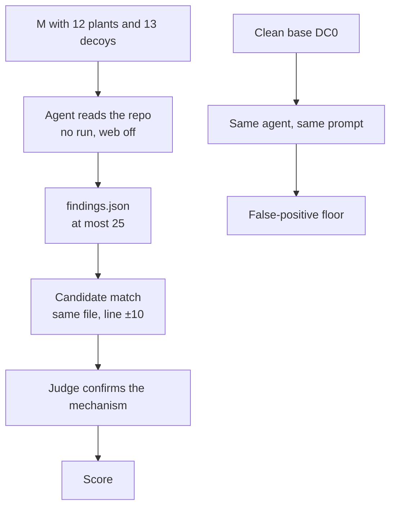
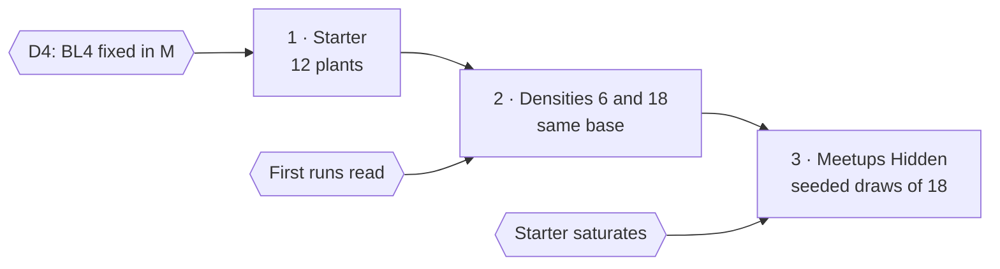

## The answer

Start Type B on the Meetups reference (M) with the 12 plants and 13 decoys below, web off, Vite Doctor and `tsc` allowed, and run every agent on the clean base too. M is already graded and needs no new features for these plants, so the first runs measure how well an agent reads code, and the 80-plant pool is ready for denser draws once those runs are read.

> [!IMPORTANT]
> **Your call:** take my recommendation on all four Type B decisions, D1 to D4 in the table below?

> [!WARNING]
> M isn't a clean base yet. `cover.put.ts` reads the whole upload before its size check (BL4), so every clean-base run that reports it needs a human to confirm it. D4 fixes it first.

## Decisions

Each row is a yes or no. The arguments are folded under the table.

| # | Decision | Recommend | Other choice |
| --- | --- | --- | --- |
| D1 | Vite Doctor and `tsc` in B | :badge[Allow both]{color="success"} headline recall on Doctor-blind plants | files only |
| D2 | Ship a `PRODUCT.md` with the intended access rules | :badge[Yes]{color="success"} access rules only | no file |
| D3 | A real bug we didn't plant | :badge[Neutral]{color="success"} a human confirms it, it joins the manifest | a bonus |
| D4 | Fix M's native bugs before it becomes the clean base | :badge[Yes, BL4 now]{color="success"} Q16 stays | leave M as graded |

::accordion
:::accordion-item{label="D1 · Vite Doctor and tsc in B"}
- **For:** both are static, and real users have them. Splitting recall by Doctor visibility shows whether the agent reads code or runs tools.
- **Against:** 9 of the 80 plants become a lint run, and 2 of the 12 starter plants (SSR1, EN2).
- **Seats:** Grok allows it and reports without Doctor-visible plants; Fable splits recall; Sol wants files only.
:::

:::accordion-item{label="D2 · PRODUCT.md with the intended access rules"}
- **For:** without it, a public seats route (DC6), a 404 for strangers (DC7) and attendee emails in a public payload (SEC7) depend on product intent, and the judge has no ground truth.
- **Against:** real repos rarely carry one, and a long one points at the plants. Keep it to access rules, write it before planting, and ship the same file in DC0.
- **Seats:** none took a side; it is open question 11 in the corpus. The recommendation is mine.
:::

:::accordion-item{label="D3 · Real unplanted findings"}
- **For:** a bonus makes the score depend on how complete our manifest is.
- **Against:** an agent that finds a real bug gets no credit in that run.
- **Seats:** Opus and Grok say neutral; Sol says investigate and version the benchmark.
:::

:::accordion-item{label="D4 · Fix M's native bugs first"}
- **For:** BL4 is a real high-severity bug in M today. While it stays, every clean-base run that finds it needs a human, and BL4 can't be planted as a case. The fix at the pin is one call, `assertBodySize(event, limit)` before `formData()`.
- **Against:** M is graded at 10, so the upload probes need a regrade. Q16 is correct on a Node host (decoy DC20), so it stays in M and is planted only in the Cloudflare variant.
- **Seats:** the corpus's BL4 entry says to fix the base before it becomes the oracle, then plant the bug back.
:::
::

## How a run works

The agent reads the repo without running it and writes its findings; a second run on the clean base gives its false-positive floor.

The prompt asks for `findings.json` with `file`, `line`, `severity`, `title` and `explanation`, at most 25, most severe first. It never says how many bugs there are. The score:

| Dimension | Weight | How |
| --- | --: | --- |
| Severity-weighted recall | 40 | critical 4, high 3, medium 2, low 1; matched weight over planted weight |
| Precision | 25 | decoy hit −2, false or speculative finding −1, style nit −0.25 |
| Explanation | 20 | per matched plant, 0 to 2 each for mechanism, trigger and fix direction |
| Severity order | 15 | Kendall τ over matched plants, plus severity within one tier of the manifest |

::details{summary="Where the seats disagreed on the weights"}
- **Precision:** 25 (Opus, Grok) or 30 (Sol, Fable).
- **Explanation:** 20 or 15. **Severity:** 15 or 10.
- **Merge:** three seats give explanation 20 and severity 15, and precision takes the rest, so 40 / 25 / 20 / 15.
::

## The starter fixture

M at the pin `1e807fc9`, comments stripped, no new features. Ten of the 12 plants have no Doctor rule.

| Plant | What | Severity | File | Doctor |
| --- | --- | --- | --- | --- |
| AU7 | Signed in is treated as owner (read form) | :badge[critical]{color="error"} | `attendees.get.ts` | no |
| SEC1 | Mass assignment through a body spread | :badge[critical]{color="error"} | `index.patch.ts` | no |
| KV5 | A cache shows one user's data to another | :badge[critical]{color="error"} | `[slug]/index.get.ts` | no |
| SSR1 | Request data in module scope (app form) | :badge[critical]{color="error"} | `app/composables/useAuth.ts` | yes |
| EN2 | The API key ships to the browser | :badge[critical]{color="error"} | `nuxt.config.ts`, `app/plugins/rates.ts` | yes |
| SEC2 | Open redirect through `external: true` | :badge[high]{color="warning"} | `app/pages/sign-in.vue` | no |
| BL2 | An uploaded SVG runs script | :badge[high]{color="warning"} | `cover.put.ts` | no |
| AU5 | Reset links built from the Host header | :badge[high]{color="warning"} | `server/auth.ts` | no |
| DB1 | Seats left goes negative | :badge[high]{color="warning"} | `rsvp.post.ts` | no |
| Q1 | A failed send is logged and the job succeeds (logged form) | :badge[high]{color="warning"} | `server/utils/mail.ts` | no |
| SEC8 | The CSV export runs formulas | :badge[medium]{color="neutral"} | `attendees.csv.get.ts` | no |
| DB9 | `lower(city)` defeats the index | :badge[low]{color="neutral"} | `events/index.get.ts` | no |

## The decoys

Each decoy looks wrong and is correct, and a finding on one costs 2 points of precision. 13 go into the starter; the rest wait for the clean base and later variants. File references are M unless noted.

| Id | Code | Looks like | Why it is correct | Starter |
| --- | --- | --- | --- | --- |
| DC0 | the comment-stripped base, nothing planted | anything | control: its findings are the false-positive floor | :badge[control]{color="neutral"} |
| DC1 | `set({ ...input })` with `input` from `readValidatedBody` | mass assignment | `z.object` strips unknown keys by default | :badge[yes]{color="success"} |
| DC2 | `navigateTo(String(route.query.redirect))`, no `external` | open redirect | Nuxt throws `NUXT_E2001` for `//x`, `/\x`, `/<tab>x` | :badge[yes]{color="success"} in `sign-up.vue` |
| DC3 | `LIKE ${containing(q)} ESCAPE '\\'` in a `sql` template | SQL injection | template values are bound parameters | :badge[yes]{color="success"} |
| DC4 | JSON POST routes with no CSRF token | CSRF | Better Auth's cookie is `SameSite=Lax` | :badge[yes]{color="success"} |
| DC5 | `swr: 60` on `/` while the header shows the user | cached personal HTML | cache rules strip cookies; at worst a flash, never a leak | :badge[yes]{color="success"} |
| DC6 | `/api/events/[slug]/seats` without auth | missing auth | seat counts are public and hold no personal data | :badge[yes]{color="success"} |
| DC7 | `findOwnedEvent` answers 404 to a stranger | wrong status | it doesn't confirm the event exists | :badge[yes]{color="success"} |
| DC8 | the reset mail sent inline, not queued | should use Queue | a job would keep the token on disk | :badge[yes]{color="success"} |
| DC9 | a `'` prefix on CSV cells | data corruption | defuses formula injection | :badge[no]{color="neutral"} SEC8 rewrites it |
| DC10 | `requireRateLimit` after validation | ordering bug | a form with mistakes doesn't use the quota | :badge[yes]{color="success"} |
| DC11 | `blob.del(found.coverPath)` after a successful swap | data loss | the old object is orphaned once the swap succeeds | :badge[yes]{color="success"} |
| DC12 | `Cache-Control: immutable` on `/images` | stale covers | each upload gets a random-suffix path | :badge[no]{color="neutral"} kept for 12 + 12 |
| DC13 | `started` from `Date.now()` in the API handler | hydration mismatch | the server decides it and the payload carries it | :badge[yes]{color="success"} |
| DC14 | EL's Gmail push route verifies a Google JWT, no shared secret | unauthenticated webhook | the JWKS-verified token is the authentication | :badge[no]{color="neutral"} EL |
| DC15 | fixed-key `useState("locale")` in a composable | cross-request leak | `useState` is request-scoped on the server | :badge[yes]{color="success"} |
| DC16 | two components sharing an async-data key, same loader | key collision | deliberate shared state | :badge[no]{color="neutral"} to add |
| DC17 | a module-scope Zod schema or constant config | module-scope state | immutable, holds no request data | :badge[no]{color="neutral"} later |
| DC18 | one `INSERT … SELECT … WHERE count < capacity` | race | one statement is atomic on SQLite and D1 | :badge[no]{color="neutral"} DB1 rewrites it |
| DC19 | EL's push debounce, `kv.get` then `kv.set` | race | the D1 lease already serializes syncs | :badge[no]{color="neutral"} EL |
| DC20 | `idempotencyKey` on the enqueue, Node host | redundant or broken | supported on Node; Q16 is Cloudflare only | :badge[no]{color="neutral"} DB1 rewrites it |
| DC21 | the reset mail logs its error and doesn't throw | swallowed error (Q1) | the response doesn't wait on it; the visitor can ask again | :badge[yes]{color="success"} |

## Tools and web

B is a reading test, so nothing runs and nothing comes from the web.

| Tool | In B | Why |
| --- | --- | --- |
| Web | :badge[off]{color="error"} | the reference and the fix commits are online; Grok, Fable and Sol agree |
| Vite Doctor | :badge[allowed]{color="success"} | D1 |
| `tsc` | :badge[allowed]{color="success"} | D1 |
| Running the app, tests or a dev server | :badge[off]{color="error"} | the eval is static |
| The number of plants | never given | an agent would stop at the count |

Recall is reported twice, over all plants and over Doctor-blind plants only. In the starter, Doctor-blind plants carry most of the weight.

:progress{value=30 max=38 label="Starter recall weight on Doctor-blind plants"}

## Matching a finding to a plant

A finding scores only after both checks pass; most runs settle on the first one with no model.

| Step | Rule |
| --- | --- |
| Candidate | the finding names the plant's file and a line within ±10, or the same function, or a second file the manifest lists |
| Confirm | the judge checks the explanation against the manifest's one-line cause |
| One to one | one finding matches one plant |
| Cap | findings past 25 are ignored |
| Unplanted | a real bug outside the manifest follows D3 |

## Real bugs we found in our own code

Three plants came from our own code, and each was rechecked against source during the merge.

| Id | Where | What | Severity | Status |
| --- | --- | --- | --- | --- |
| BL4 | M `cover.put.ts:18` | reads the whole form before the size check | :badge[high]{color="warning"} | :badge[verified]{color="success"} |
| Q16 | M `rsvp.post.ts:33-34`, `event-reminders.ts:27-28` | `idempotencyKey` refused on Cloudflare; the error is only logged | :badge[high on Cloudflare]{color="warning"} | :badge[verified]{color="success"} |
| HB2 | `site/server/utils/ingest.ts:8` | the ingest token compared with `!==` | :badge[low]{color="neutral"} | :badge[verified]{color="success"} |

::accordion
:::accordion-item{label="BL4 · The upload buffers the body before the size check"}
- **Code:** `event.req.formData()` at line 18; `ensureBlob`'s size check at line 22.
- **Effect:** a chunked 2 GB "photo" sits in memory before anything refuses it. A chunked body has no `Content-Length` to check.
- **Fix:** at the pin, `assertBodySize(event, limit)` or h3's `bodyLimit` middleware before `formData()` (h3 2.0.8). On main, `blob.handleUpload` checks first (`58e55cf29b`, vite-hub/vitehub#4215).
- **For B:** D4. Once M is fixed, BL4 is a high plant like any other.
:::

:::accordion-item{label="Q16 · M sends no mail on Workers"}
- **Code:** `runQueue(…, { idempotencyKey })`, then `if (error) console.error(…)`. The pin's Cloudflare provider returns `QUEUE_UNSUPPORTED_OPTION` before `binding.send` (pin `packages/queue/src/providers/cloudflare.ts:61-66`, `:149-150`; refused options at `errors.ts:10`).
- **Effect:** on Workers no confirmation or reminder is ever queued, and users see no error. M builds `preset: "node"`, so the bug is latent.
- **Fix:** drop the key on Cloudflare. The handler's claim (`mail.ts:27-30`) already dedupes.
- **For B:** a plant only in the Cloudflare variant (M-cf). On Node the same code is decoy DC20.
:::

:::accordion-item{label="HB2 · The site's ingest token compare"}
- **Code:** `requireIngestToken` compares the `Authorization` header to the `Bearer` string with `!==`.
- **Effect:** the compare is not constant time, so it leaks timing on the runner's token. Low on its own.
- **Fix:** a constant-time compare, as ViteHub did in `67a98b13a9`.
- **For B:** a plant-only id. The site needs the fix whatever we decide for B; it is outside M.
:::
::

## The plant pool

The pool has 80 plants: 71 fix cases under their own ids and 9 plant-only ids, HB1 to HB9. Most are medium, and 70 of the 80 have no Doctor rule.

::chart{type="stacked" horizontal title="Plants per severity, by what Vite Doctor sees"}
| severity | Doctor-blind | Doctor sees the bare form | Doctor names it |
| --- | --: | --: | --: |
| critical | 7 | 0 | 2 |
| high | 16 | 1 | 1 |
| medium | 32 | 0 | 5 |
| low | 15 | 0 | 1 |
::

Severity is the proposed manifest value; freeze it per fixture before the runs. Bold ids are in the starter. A fixture code in brackets means the plant needs that fixture, not M: EL is the email-labeller, J the jobs fixture, L Meetups-legacy, V a small viewer app, and "cloudflare" means M-cf.

::accordion
:::accordion-item{label="Critical (9)"}
| Id | Plant | File area | Static signal | Doctor |
| --- | --- | --- | --- | --- |
| **AU7** | Signed in is treated as owner | `attendees.get.ts`, `attendees.csv.get.ts`, `index.patch.ts`, `cover.delete.ts` | `findEventBySlug` after `requireUser` on an owner-only route | no |
| AU4 | A path-compare guard misses `/export/` | `server/middleware/admin.ts` | guard by exact `pathname ===` | no |
| **SEC1** | Mass assignment through a body spread | `index.patch.ts`, `account.patch.ts` | `readBody` spread into `.set()` | no |
| SEC7 | Attendee emails in the public event payload | `[slug]/index.get.ts` | organizer helper selecting `email` in a public route | no |
| **KV5** | A cache shows one user's data to another | `[slug]/index.get.ts` | cached function whose `getKey` omits the user it reads | no |
| **SSR1** | Request data in module scope | `useAuth.ts`, `server/utils/session.ts` | module-scope `ref` or `let` holding the user | yes |
| **EN2** | The API key ships to the browser | `nuxt.config.ts`, `app/plugins/rates.ts` | secret under `runtimeConfig.public` or `VITE_` | yes |
| BL1 | The served store publishes private files | `server/api/tickets`, `nuxt.config.ts` blob | private files in the served store; `access: 'private'` | no |
| DB5 | A generated migration cascades on D1 | `migrations/*.sql` (ST) | `DROP TABLE user` in a generated rebuild | no |
:::

:::accordion-item{label="High (18)"}
| Id | Plant | File area | Static signal | Doctor |
| --- | --- | --- | --- | --- |
| RT1 | Signed in can write any document | `server/realtime/*` (V) | `auth: true` with no `authorize` | no |
| **AU5** | Reset links built from the Host header | `server/auth.ts` | `baseURL: requestOrigin`, `trustedProxyHeaders` | no |
| AU6 | The sign-up hook trusts the email | `server/auth.ts` hooks (ST) | email domain decides "server-made" | no |
| AU8 | The body picks the event | `co-organizers.post.ts` | event id from the body | no |
| AU9 | The CSRF and origin checks turned off | `server/auth.ts` | `disableCSRFCheck: true` | no |
| **BL2** | An uploaded SVG runs script | `cover.put.ts` | `types: ['image']`, no byte check | no |
| BL4 | The upload buffers the body before the size check | `cover.put.ts` | `formData()` before any size check | no |
| BL8 | The upload trusts the client's path | `cover.put.ts` | storage key from client input | no |
| **SEC2** | Open redirect through `external: true` | `sign-in.vue` | `navigateTo(query.redirect, { external: true })` | no |
| SEC3 | Stored XSS through `v-html` | event description, comments | `v-html` on user Markdown | yes |
| SEC4 | The cancel link is a state-changing GET | `cancel.get.ts` | a GET route that deletes | no |
| SEC5 | The sort parameter goes through `sql.raw` | `events/index.get.ts` | `sql.raw` with query input | no |
| SEC9 | The payment webhook is unsigned | `webhooks/payments.post.ts` | no signature check; `===` on a secret | no |
| **DB1** | Seats left goes negative | `rsvp.post.ts` | count read, then insert | no |
| **Q1** | A failed send is logged and the job succeeds | `server/utils/mail.ts` | `email.send` error logged, not rethrown | bare form only |
| Q2 | A retried job sends the email again | `mail.ts` | send before the sent-at claim | no |
| Q16 | `idempotencyKey` refused on Cloudflare | `rsvp.post.ts`, `event-reminders.ts` (cloudflare) | `idempotencyKey` with a Cloudflare queue; error only logged | no |
| HB7 | Cookie auth with `SameSite=None` and no origin check | cookie-auth writes | cookie attributes plus no `sameOriginWrites` | no |
:::

:::accordion-item{label="Medium (37)"}
| Id | Plant | File area | Static signal | Doctor |
| --- | --- | --- | --- | --- |
| AU10 | A removed privilege lives on in the cookie cache | export route | authorization read from a cookie-cached session | no |
| AU12 | Forgot-password timing tells who has an account | `server/auth.ts`, `mail.ts` | reset response awaits the send | no |
| Q3 | Reminders arrive twice, or never | `event-reminders.ts` | time window with no sent-at filter | no |
| Q8 | A module-level lock that doesn't lock | `server/lib/sync.ts` (EL) | module-level `running` promise as a lock | no |
| Q10 | A late progress update overwrites "completed" | `updateJob` (J) | KV get-spread-set of a status | no |
| Q11 | A notification sent from a GET | GET handler (J) | side effect in a GET | no |
| Q13 | The RSVP waits for the mail provider | `rsvp.post.ts` | awaited send in the request | no |
| Q14 | Push watch started before the cursor | `sync.ts` (EL) | watch before cursor | no |
| KV1 | A single-use code works twice | `redeem.post.ts` | `kv.get` then `kv.set` on one key | no |
| KV4 | A memoized promise keeps its rejection | rates client | `x ??= promise` with no reset on rejection | no |
| KV7 | A search cache that never forgets | `events/index.get.ts` | module `Map` cache with no bound | no |
| RL1 | The rate limit never trips | `rsvp.post.ts` | unawaited guard; `if (!(await checkRateLimit))`; limiter in handler | yes |
| RL3 | The limit is keyed on a spoofable header | `rsvp.post.ts`, sign-up | `key` from `x-forwarded-for` | no |
| EN1 | A sealed secret is sent as redacted text | `rates.get.ts` | sealed secret interpolated | yes |
| DB4 | D1's 100 bound parameters | `invites.post.ts`, `dashboard.get.ts` (cloudflare) | wide `values()` or `inArray` over ids | no |
| DB6 | Lowering capacity below the people going | `index.patch.ts` | count, then unconditional capacity update | no |
| DB12 | The deploy skips the migrations | release script (L) | deploy with no migrate step | no |
| SSR3 | The venue time is read in the server's zone | `events/index.post.ts` | `new Date(datetimeLocal)` | no |
| SSR4 | The SSR fetch drops the session cookie | session plugin | plain `$fetch` to an internal route in SSR | no |
| SSR6 | Two cards share one async-data key | event previews | one explicit key for different ids | no |
| SSR8 | An older search result wins | search composable | async watcher with no cancel or generation | no |
| SEC6 | Database errors sent to the browser | `server/utils/handle.ts` | `e.message` and `data` in `createError` | no |
| **SEC8** | The CSV export runs formulas | `attendees.csv.get.ts` | plain `join(",")` | no |
| MG4 | The redirect runs the mutation under it | organizer handler (L) | `redirect()` without `return` before a write | no |
| MG5 | Middleware that protected a prefix now matches one path | h3 adapter (L) | `app.use('/admin', guard)` | no |
| MG6 | The webhook signature is checked on re-serialized JSON | webhook (J) | signature over re-serialized JSON | no |
| MG7 | A proxy drops the second Set-Cookie | session proxy (V) | one `Set-Cookie` value, comma split | no |
| MG2 | Migrated KV calls use the tuple as the value | settings, cursor (L, J) | KV result used as the value | yes |
| Q5 | A workflow retry repeats a finished side effect | workflow (J) | one step around several effects | no |
| Q6 | A job payload over Cloudflare's 128 KB | `cover.put.ts` (cloudflare) | base64 file in a queue payload | no |
| Q7 | One poison message stops the inbox | `sync.ts` (EL) | cursor advances only after `Promise.all` | no |
| HB1 | LIKE without `ESCAPE`, so `%` matches everything | `events/index.get.ts` | LIKE on user input with no ESCAPE | no |
| HB3 | A claim not released on an early `return` | a job handler | claim, then `return` before release | no |
| HB4 | Queue options inside the payload | an enqueue call | `{ payload, delaySeconds }`; VHUB0016 | yes |
| HB5 | An enqueue at module scope | a Nitro plugin | VHUB0017 | yes |
| HB6 | A GET that writes reads stale data on D1 replicas | a GET that writes | write inside a GET | no |
| HB8 | A provider error shows a partner's account names to the household | a sync status route | raw provider error in a shared response | no |
:::

:::accordion-item{label="Low (16)"}
| Id | Plant | File area | Static signal | Doctor |
| --- | --- | --- | --- | --- |
| BL9 | An R2 binding can't presign | upload route (cloudflare) | `blob.sign` with only a binding | no |
| BL5 | The new cover never shows | `cover.put.ts`, `nuxt.config.ts` | reused path plus `immutable` | no |
| BL6 | Cards download full-size covers | `EventCard.vue` | `/images/<path>` without `?w=` | no |
| SSR2 | Times render differently on server and client | `EventStart.vue`, `EventCard.vue` | `toLocaleString`, `Date.now()` in render | yes |
| SSR5 | A setup `$fetch` runs twice | events page | top-level `$fetch` in setup | no |
| SSR7 | A manual watcher doubles every filter request | search page | `useFetch` with reactive query plus a manual `refresh` watcher | no |
| SSR10 | A watcher outlives its component | lazy widget (V) | `watch` inside a promise callback | no |
| MG13 | Shallow refs break an old inline editor | editor (L) | in-place mutation of `useFetch` data | no |
| DB2 | One seat-count query per event | `dashboard.get.ts` | helper query inside a loop | no |
| **DB9** | `lower(city)` defeats the index | `events/index.get.ts` | `lower(column) =` on an indexed column | no |
| DB10 | A missing index, fixed without a migration | `my-rsvps.get.ts`, schema | `where user_id` with no index on it | no |
| DB13 | The list ships every column | `events/index.get.ts` | `select()` with no columns in a list | no |
| KV3 | A hand-rolled rates cache stampedes | `rates.get.ts` | module-variable cache with an `await` between check and set | no |
| KV8 | An activity feed kept in one KV value | activity feed | `kv.get`, push, `kv.set` of an array | no |
| HB2 | Bearer token compared with `!==` | a bearer-token check | string compare on a secret | no |
| HB9 | `setTimeout` in a `watch` with no `onCleanup` | a component | timer in a watcher | no |
:::

:::accordion-item{label="Evidence for HB1 to HB9"}
| Id | Evidence |
| --- | --- |
| HB1 | Drop `f369d248`; rubric B12 failed in 6 of 15 runs. M has the correct form at `index.get.ts:20-22` |
| HB2 | nuxt-evals `site/server/utils/ingest.ts:8`, verified; ViteHub `67a98b13a9` |
| HB3 | babysitter `39f7a3fd7` |
| HB4 | Doctor rule VHUB0016 (pin `doctor-rules.md:75`, verified) |
| HB5 | Doctor rule VHUB0017 (pin `doctor-rules.md:76`, verified) |
| HB6 | ViteHub `022a06da40` (vite-hub/vitehub#2693) |
| HB7 | joxi `1c973b6` |
| HB8 | joxi `1fd3769` |
| HB9 | Drop `0664609b` |
:::
::

## Growing the fixture

Each stage starts only when the one before it has been read. Hexagons are what has to happen first.

| Stage | Base | Plants | Starts when |
| --- | --- | --- | --- |
| 1 · Starter | M at the pin | the 12 above | D4 lands |
| 2 · Densities | M | 6 and 18 | the first runs are read; does recall fall as plants crowd? |
| 3 · Meetups Hidden | M plus five plant-hosting features (M+ lists tickets, invite codes, comments, recordings, a webhook) | a 30-plant pool, seeded draws of 18 | the starter saturates |

40 of the 71 fix-case plants fit M as it is, and 10 more need an M+ feature. The other 21 need L, M-cf, J, V, EL or ST, so they stay out of B until those fixtures exist. Decoys that a plant removes (DC9, DC18, DC20) return in the clean base and in later draws.

## Why the bugs get written

The corpus tags every case with one or two of twelve causes. Trust boundaries and names that sound safer than they are lead among the plants.

::chart{type="bar" horizontal labels title="Fix-case plants per cause (a plant with two tags counts twice; HB1 to HB9 are untagged)"}
| cause | plants |
| --- | --: |
| W9 Trust boundaries are per file | 13 |
| W12 Names that read like guarantees | 12 |
| W5 Check, await, act | 11 |
| W7 The short form over-fetches | 10 |
| W1 Local hides remote | 7 |
| W2 Dev defaults and host limits differ | 7 |
| W3 Two runtimes, one file | 7 |
| W6 At-least-once delivery | 7 |
| W8 API drift | 6 |
| W10 Cache as a speed patch | 5 |
| W4 Errors as values | 4 |
| W11 The schema lives in three places | 3 |
::

Six causes leave a mark in one file. W2, W8 and W12 show only to a reader who knows the host, the versions or the primitive, and that is where B separates agents that know ViteHub from agents that only read code.

| Cause | Static signal | What a reader sees |
| --- | --- | --- |
| W3 Two runtimes | :badge[in the file]{color="success"} | module-scope `ref`, `Date.now()` in render |
| W4 Errors as values | :badge[in the file]{color="success"} | an `await` with no destructure, or `[error]` only logged |
| W5 Check, await, act | :badge[in the file]{color="success"} | read, `await`, then write on the same row or key |
| W7 Short form | :badge[in the file]{color="success"} | `select()`, raw `readBody`, a global plugin |
| W9 Trust boundaries | :badge[in the file]{color="success"} | a route trusting ids, Host or `x-forwarded-for` from the request |
| W10 Cache as a patch | :badge[in the file]{color="success"} | a cache key that omits an input the value reads |
| W1 Local hides remote | :badge[partly]{color="warning"} | the loop or the serial awaits show; the cost doesn't |
| W6 At-least-once | :badge[partly]{color="warning"} | a send before the claim shows; the retry needs the delivery model |
| W11 Schema in three places | :badge[partly]{color="warning"} | a generated `DROP TABLE` shows; production's state isn't in the repo |
| W2 Host limits | :badge[needs the host]{color="neutral"} | only next to a Cloudflare preset |
| W8 API drift | :badge[needs the versions]{color="neutral"} | an API from an older Nuxt, h3, Nitro or NuxtHub |
| W12 Safe-sounding names | :badge[needs the primitive]{color="neutral"} | `auth: true`, `types: ['image']`, `external: true` |

## How I checked

> [!CAUTION]
> **Not verified:** the severities are the corpus's proposed manifest values (Grok's seat for the starter), not frozen. The Doctor column comes from the corpus; I ran Vite Doctor on no plant. DC1 (Zod strips unknown keys), DC4 (`SameSite=Lax`) and DC14 rest on seat reads the merge didn't recheck. The static-signal column under the causes is my read. D2's recommendation is mine; the corpus leaves it open. The corpus's section 7 says "12 plants, 12 decoys" but lists 13 decoy ids; this page uses the 13. The Grok seat ran on Opus because the Grok balance ran out, so Opus wrote two of the four council seats.

::details{summary="Sources and method"}
- **Corpus:** `research/corpus/corpus-v0.md`, merged on 2026-11-14 from `council-opus.md`, `council-sol.md`, `council-grok.md` and `council-fable.md`. Sections 2 (causes), 3 (scoring, matching, fixtures, disagreements), 6 (plants and decoys), 7 (starter) and 8 (open questions 2, 3, 4 and 11).
- **Versions:** M installs ViteHub at `1e807fc9` (2026-11-08); `nuxt-nightly@5.0.0-2611070044-e3875e8`, `nitro@3.0.261103-rc`, `h3@2.0.8`, `ocache@0.3.1`.
- **Rechecked for this page:** `cover.put.ts:18` (the `formData()` call) and `:22` (`ensureBlob`); `rsvp.post.ts:33-34` (the logged `runQueue` error); `site/server/utils/ingest.ts:8` (the `!==` compare).
- **Counts:** severity, Doctor and cause counts are computed from the corpus's plant table and index, 71 fix-case plants plus HB1 to HB9.
::
