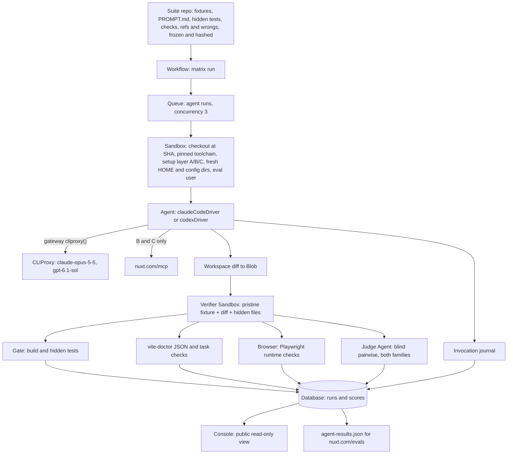

# Nuxt agent tooling evals on ViteHub

**The ocean:** a public, reproducible eval suite, run on ViteHub primitives. It measures, task by task and primitive by primitive, whether the Nuxt MCP, the core Nuxt skill and module skills make Claude Opus 5.5 (Claude Code) and Sol 6.1 (Codex) pick the *best* Nuxt 5 / Nitro v3 / h3 v2 primitives compared with a truly bare setup. Every run, transcript, diff and score shows in a public ViteHub Console view, and the format can feed nuxt.com/evals.

> [!IMPORTANT]
> **Recommendation:** keep the nuxt-evals task format (`PROMPT.md`, hidden tests, build) so nuxt.com can use the results. Replace pass@4 with a **best-primitive rate**: the run passes the gate, every required check passes, and no tempting-wrong check fires. Run the agents through ViteHub's `claudeCodeDriver()` and `codexDriver()` behind `cliproxy()`. Grade in a separate verifier sandbox. Build one missing primitive before launch: a public, redacted, read-only Console view.
>
> **Biggest risk:** the rubric is circular if it comes from the skills under test. Write every check from the Nuxt docs, freeze it before any skill edit, and have Nuxt team members write the held-out tasks.

## 1. What the research found

### Prior art

| Suite | What it does | What we take from it |
| --- | --- | --- |
| [vercel/nuxt-evals](https://github.com/vercel/nuxt-evals) (feeds [nuxt.com/evals](https://nuxt.com/evals)) | Each task has `PROMPT.md`, a hidden vitest `EVAL.ts` (mostly regex on source) and a `build` script. `runs: 4, earlyExit: true`. Fixtures pin `nuxt ^4.3.1`. Results go to nuxt.com as a hand-copied `agent-results.json`. An MCP experiment exists but no results are published. Opus 5.5 scores 100% pass@4 and 97% first try. | The task layout and the export path. Some tasks already reject an anti-pattern (`onMounted` fetch, `new Date` in template). The scores show that the tasks are saturated. |
| [@vercel/agent-eval](https://github.com/vercel-labs/agent-eval) | `setup` hook for MCP servers and skills, `verifier: 'separate'`, `disableBundledSkills`, and a judge that by default is the **same model as the agent**. Its Claude Code parser maps `mcp__*` and `Skill` calls to `unknown`. | Grade in a separate sandbox. Pin the judge. Parse raw transcripts ourselves. |
| [next-evals-oss](https://github.com/vercel/next-evals-oss), [Vercel: AGENTS.md outperforms skills](https://vercel.com/blog/agents-md-outperforms-skills-in-our-agent-evals) | Base and AGENTS.md columns side by side. On post-cutoff Next.js 16 APIs: baseline 53%, skill 53%, skill plus an instruction 79%, AGENTS.md docs index 100%. **The skill was not invoked in 56% of runs.** | Log whether the tool was used. Post-cutoff APIs are where tooling can make a difference. An AGENTS.md index is the control that could refute "skills are needed". |
| [sveltejs/svelte-evals](https://github.com/sveltejs/svelte-evals) | Six experiments (basic, mcp, mcp-prompt, skill, skill+mcp…). Hidden static checks plus browser tests. `runs: 1`. | The closest shape to setups A/B/C. Its weakness is one run per cell. |
| [angular/web-codegen-scorer](https://github.com/angular/web-codegen-scorer) | Each check subtracts a weighted share of the score: build, runtime errors while served, a11y, CSP. An LLM rating counts for up to 30%. Supports Claude Code, Codex and Gemini CLI with an `--mcp` flag. | A score built from weighted deductions, not a binary pass. |
| [Laravel Boost benchmarks](https://laravel.com/blog/which-ai-model-is-best-for-laravel), [follow-up](https://laravel.com/blog/idiomatic-laravel-ai-coding-agents) | 17 tasks, with and without Boost, 6 models. Boost helped or matched every model. **Single run.** They saw 7/19 become 17/19 just by running again, and call the results "directional". The follow-up takes its judge rubric from their own best-practices skill. The harness is closed. | **The answer to Atinux:** yes, Laravel has with/without evals, but they are weak evidence. Don't copy the circular rubric. |
| [Convex evals](https://github.com/get-convex/convex-evals) | A grader must pass valid alternative answers and reject plausible wrong ones. | Validate every check against reference and wrong solutions. |
| [Nolan Lawson, Oct 2026](https://nolanlawson.com/2026/10/28/the-ai-cost-of-javascript-frameworks/) | Opus 5.5, 5 runs, with the official MCPs and skills installed: **the Nuxt MCP was never used**. The Svelte MCP was used 5/5. | Hugo's point has evidence behind it. Measure invocation, and report results both for all runs and for runs where the tool was used. |
| SWE-bench, [Harbor](https://github.com/harbor-framework/harbor), Anthropic [skill-creator](https://github.com/anthropics/skills/tree/main/skills/skill-creator) and [Demystifying evals](https://www.anthropic.com/engineering/demystifying-evals-for-ai-agents) | Hidden FAIL_TO_PASS tests, a clean container per trial, mean ± stddev, pass^k instead of pass@k. Skills tend to undertrigger. | Hidden tests, a clean environment, and spread instead of best-of-k. |
| Judge bias: [Panickssery 2024](https://arxiv.org/abs/2404.13076), [Zheng 2023](https://arxiv.org/abs/2306.05685), [Miller 2024](https://arxiv.org/abs/2411.00640) | Self-preference, position and verbosity bias. Paired, clustered errors when you compare setups. | Blind pairwise judging with swapped order, and statistics paired by task. |

### ViteHub today (origin/main 4763b4fba, 2026-11-07)

| Need | Primitive | State |
| --- | --- | --- |
| Run Claude Code / Codex headless | `@vite-hub/agent` `claudeCodeDriver()` / `codexDriver()` (pinned `claude-agent-sdk` 0.3.246, `@openai/codex` 0.149.1) | Exists. Pinned versions help reproducibility. |
| Route models to CLIProxy | `@vite-hub/gateways` `cliproxy()` (`CLIPROXY_URL`, `CLIPROXY_API_KEY`, `cloudflareAccess()` headers) | Exists. CLIProxy serves `claude-opus-5-5` and `gpt-6.1-sol` (checked through `/v1/models`). |
| Isolated run environment | `@vite-hub/sandbox`: `trusted-host` (cgroup memory cap only), `crabbox`/SSH, Cloudflare, Vercel, custom runtimes. Private HOME per session, `checkout` pinned to a SHA, `toolchain: "project"`. | Partial. No Docker runtime, no generic snapshot of a prepared project, no CPU or PID caps. |
| Fan-out with limits | `@vite-hub/workflow` (OpenWorkflow on SQLite on Node), `@vite-hub/queue` (local provider, per-definition `concurrency`) | Exists for one host. No global cap across processes. |
| Artifacts and scores | `@vite-hub/database` (SQLite/libSQL), `@vite-hub/blob` (fs/S3, `serve.anonymous`) | Exists. |
| Diff of agent changes | `@vite-hub/workspace` diff, snapshot, checkpoint | Exists. |
| Runtime checks | `@vite-hub/browser` with local Chromium plus Playwright | Partial. No helpers for hydration warnings, request counts or payload size. |
| Scoring harness | `vite-hub/agent/eval` (`defineEval`, scenarios, variants, scorers such as `callsTool` and `staysUnderTokenBudget`; runs through evalite) | A seed only. No build, test, diff, browser or LLM-judge scorers. |
| Transcript and diff viewer | Agent invocation journal, `@vite-hub/ui` Trace and Diff components, Console Agents section | Exists for operators. |
| Public read-only view | Console at `/_vitehub`, with GitHub, app, Cloudflare Access or `authorize()` grants | **Missing.** There is no anonymous redacted mode, and [#3548](https://github.com/vite-hub/vitehub/pull/3548) refuses `auth: false` in production. |
| Live run stream | Realtime is Yjs documents only | **Missing.** Poll the journal for v1. |

### Local Nuxt tooling

- **Versions.** Nuxt 5 exists only as `nuxt-nightly@5x` (`5.0.0-2611070044-e3875e8` today). `nuxt@latest` is 4.6.4. `nitro` is `3.0.261103-rc` and `h3` is `2.0.8`. Pin one nightly SHA, or the target moves between runs.
- **Skills (nuxt/skills).**
  - The core `nuxt` skill targets Nuxt 5 and the `nitro` skill targets Nitro v3 beta.
  - Module skills (nuxthub, content, better-auth, nuxt-ui chat) and every nuxt-skill-hub rule still use Nuxt 4 habits: auto-imported handlers, `defineCachedEventHandler`, `statusCode`, `useStorage('cache')`.
  - Two factual errors: the nitro skill says h3 v2 dropped `readBody` (it did not), and it contradicts the nuxt skill on `useKV` vs `useStorage`.
  - There are no h3, `@nuxt/image`, `nuxt-auth-utils` or `@nuxt/scripts` skills.
  - The plugin bundles core and module skills together, so setups B and C must load skill folders one by one.
- **Nuxt MCP.** nuxt.com/mcp exposes docs, blog, deploy, changelog and module tools. It has no skill-finding tool. **Its docs version defaults to `4.x`.** Phases 3 and 4 of the plugin plan (`nuxt module add` installs skills, an MCP skill finder) are not built.
- **vite-doctor.** It is usable as a static grader:
  - `--format json` emits `vite-doctor.report/v3`, where each finding has a `ruleId`, file, range and evidence.
  - It has rules for raw fetch in setup, module-scope request state, validated body/query/params, server/client boundaries, runtime config vs `process.env`, module-scope response caches, SEO composables, `NuxtImg` and Nitro v2 imports.
  - **No rules for lazy components or payload size.**
  - Not checked yet: whether it resolves the Nuxt → Nitro → h3 graph on a nightly-aliased fixture.
- **Isolation leaks.**
  - Maxi's Codex home holds the full Nuxt skill set.
  - Codex also reads `$HOME/.agents/skills`, which `CODEX_HOME` does not move.
  - Claude Code loads the pstack plugin and 58 user skills.
  - A fresh `HOME`, `CODEX_HOME` and `CLAUDE_CONFIG_DIR` per run handles all three. Maxi's home is mode 750, so a dedicated eval user cannot read it at all.

## 2. Walls

| Reason it "can't" work | Mark | Evidence and how the plan handles it |
| --- | --- | --- |
| "Models do fine, nothing to measure" (Flo0806) | Habit, and a testable claim | nuxt.com/evals saturates because its tasks are pre-cutoff and graded by regex. Vercel saw a 53% baseline on post-cutoff APIs. Nuxt 5, Nitro v3 and h3 v2 are nightly, rc and new. **The pilot settles it.** If bare scores ≥95% best-primitive rate, we publish that. |
| "Evals are too expensive" | Habit for effort, **real wall for quota** | An agent-built harness is days of work. The CLIProxy quota and concurrency caps are not readable as `maxi`, and the management endpoint returns 401. The pilot measures tokens per run before scaling. |
| "We need a new harness" | Habit | agent-eval and ViteHub's provider drivers already run both CLIs headless. |
| "Best code can't be graded" | Habit | Most right/wrong pairs already map to vite-doctor rules. Runtime effects (double fetch, hydration, payload, state leak) are measurable with Playwright. The judge covers only the rest. |
| "Bare isn't really bare on this machine" | Habit, with a fix | Fresh HOME and config dirs, strict MCP config, Codex bundled skills off, and a dedicated Unix user. A probe per setup checks the tool and skill list in each transcript's init event. |
| ViteHub's driver may add its own tools or instructions | **Unverified, maybe real** | Provider drivers expose Capability tools through a private loopback MCP server and write driver instructions. If a bare run's tool list shows anything ViteHub added, the agent under test runs as a raw `claude -p` / `codex exec` through `sandbox` spawn, and ViteHub only orchestrates and records. |
| Nuxt 5 isn't released | Real, managed | Pin the nightly SHA, Nitro rc, h3 and module versions in a lockfile. Report them on every page. |
| Maxi writes the tasks, the rules and the skills | **Real wall (credibility)** | Freeze and hash the tasks and checks before any skill edit. Every check cites a Nuxt docs page, not a skill. Benjamin, Hugo and Daniel review the frozen tasks and write the held-out set. Losses are published. A leak check confirms that no task-specific identifier appears in a skill. |
| Slimbook is shared (16 cores, 28 GB, 15–25 agents) | Real | The agent phase is mostly network wait (~0.5–1 GB). The verifier build (1.5–2.5 GB) and Chromium go through `heavy`. Concurrency is 3 agent runs and 2 verifier builds. ServaRICA (4 cores, 15 GB, reaches CLIProxy over Cloudflare) is the overflow runner. |
| Subscription terms for automated runs | **Real wall, unchecked** | ~750 headless runs on the subscription accounts behind CLIProxy may not fit the plans' terms. Maxi decides: subscription, or API keys with a budget. |
| Public view could leak secrets | Real | Redacted, read-only grants over eval data only. No env, gateway config or host paths. |
| The Nuxt MCP defaults to 4.x docs | Not a wall | It is a property of the tool under test. Measure it and report it. Fixing the default is a nuxt.com change that needs Maxi's OK. |

## 3. Oracle and grading

Each run is graded in a **separate verifier sandbox**: the pristine fixture plus the agent's diff plus the hidden files. The agent never sees the tests or checks.

| Layer | What it measures | How | Weight |
| --- | --- | --- | --- |
| Gate | It works | `nuxt build` plus hidden behavior tests against `.output/server` (vitest with `@nuxt/test-utils` or plain fetch) | Pass or fail. Reported as its own rate, and the other layers count only after it passes. |
| Primitive checks | It uses the right primitive | Each task lists `must` checks (right primitive) and `must-not` checks (the tempting wrong one). Each check is a vite-doctor rule or a task-local AST check, never regex. A whole-project vite-doctor run adds a penalty for **new** findings compared with the fixture baseline. | ~60% |
| Runtime checks | The structure pays off | Playwright on the prod build: hydration mismatch messages, client `/api` requests on first SSR load (should be 0) and per interaction, `__NUXT_DATA__` bytes, initial route JS bytes, a state leak test (two concurrent requests with different cookies), upstream call counts for cached handlers, HTTP status for errors and auth | ~25% |
| Judge | Only what rules can't check | One rubric per task, each item citing a Nuxt docs page. A pairwise blind comparison of two diffs, labels removed, order swapped. Both model families judge every pair and disagreement is reported. Calibrate against ~50 human labels and drop the judge if agreement is low. | ~15% |
| Diagnostics | Was the tool used, and at what cost | From raw `stream-json` / `codex --json`: Nuxt MCP calls, `Skill` calls or `SKILL.md` reads, input/output/cached tokens, turns, wall time | Not scored |

**Headline metric:** the *best-primitive rate*. A run counts when it passes the gate, every `must` check passes, and no `must-not` check fires. We also publish the weighted score with median and IQR per cell, and pass^k (all k runs best).

**Comparisons:** B − A and C − B, paired by task, with bootstrap intervals clustered by task. Each comparison is shown for all runs and for runs where the tool was used.

**Grader oracle (the baseline before any agent run):**
- Each task ships **two reference solutions in different styles** and **two tempting-wrong solutions**.
- The grader must give 100% to both references and fail each wrong solution on exactly its target check, deterministically across 3 reruns.
- A check that can't separate them moves to the judge rubric or is dropped.

**Pilot checks (assumptions not yet verified):**
- Vue may hide hydration mismatch details in prod builds. The verifier sets `__VUE_PROD_HYDRATION_MISMATCH_DETAILS__` through a verifier-only config layer, or runs a dev server per task.
- vite-doctor must resolve the nightly graph.

## 4. Architecture on ViteHub

- **Host:** one Node ViteHub app (preset `node`) on Slimbook, with ServaRICA as a second runner through crabbox or SSH. It runs OpenWorkflow on SQLite, the local Queue, fs Blob and SQLite Database. Its Console is exposed through a Cloudflare tunnel, or linked to console.vitehub.dev once the hosted Console PRs land.
- **Setup layers:**
  - **A:** no MCP servers, no skills. Codex bundled skills off. Web tools off.
  - **B:** `nuxt` HTTP MCP, plus the core `nuxt` skill in project `.claude/skills` and `.agents/skills`.
  - **C:** B, plus the skills of the modules in the fixture's `package.json`, resolved by nuxt-skill-hub's resolver at a pinned version when the fixture is prepared, never at run time.
- **Agent definitions:** one per agent × setup, so the Console groups runs by definition.
- **Repo:** a new `vite-hub/nuxt-evals`. Task folders follow the nuxt-evals layout, and the platform code depends only on published ViteHub packages. Primitive gaps go to the ViteHub repo as separate PRs.

**Where this differs from the default stack:** local Chromium instead of Cloudflare Browser Run, OpenWorkflow on SQLite instead of a cloud workflow provider, and possibly raw CLIs instead of provider drivers (see Walls).

**Primitive gaps to propose, in priority order:**
1. **Public read-only Console grants with redaction** (owner: `vite-hub` console). This blocks the public launch.
2. **Eval scorers in `agent/eval`**: a command or test scorer run in a Sandbox, a judge scorer through a gateway, and a browser scorer. Prove them first as app code, then promote them.
3. **Browser runtime-check helpers** (owner: `browser`): console errors and hydration warnings, request counts per route, transfer bytes.
4. **Container runtime or prepared-project snapshots** (owner: `sandbox`), if the dedicated Unix user plus `trusted-host` proves too leaky or too slow.
5. **Journal event stream (SSE)** for live views. Polling is fine for v1.

## 5. Task catalog sketch

The prompts state a product need and never name the primitive or say "follow best practices". The fixtures are a shared shop app plus small module apps. About 25% of tasks are held out and written by Nuxt team members.

| # | Task (product need) | Right primitive | Tempting wrong | Detected by |
| --- | --- | --- | --- | --- |
| 1 | Product list from `/api/products` | `useFetch`/`useAsyncData`, awaited in setup | `$fetch` in setup, `onMounted` fetch | `nuxt/fetch/no-raw-fetch-in-setup`, 0 client API calls on SSR load |
| 2 | Search with filters in the URL | `useFetch` with reactive `query` | manual `watch` + `$fetch` | AST check, requests per change |
| 3 | Cart count shared across components | `useState` or a Pinia store | module-level `ref` in a composable | `nuxt/ssr/no-module-scope-request-state`, cookie leak test |
| 4 | Greeting that depends on time | value fixed on the server or `<ClientOnly>` / `NuxtTime` | `new Date()` in the template | hydration mismatch count |
| 5 | Call a paid API with a secret key | private `runtimeConfig` via `useRuntimeConfig(event)` in a server route | `process.env` in the app, key in `public` | `no-plain-env-in-app-code`, `no-secret-in-public-config` |
| 6 | Product page SEO from data | `useSeoMeta` | raw `useHead` meta array | `prefer-seo-composables` |
| 7 | Heavy chart below the fold | `Lazy` component + lazy hydration | eager import | route JS bytes (new rule) |
| 8 | Dashboard only for signed-in users | `defineNuxtRouteMiddleware` + `navigateTo` | `router.beforeEach` in a plugin, `onMounted` redirect | SSR 302, AST check |
| 9 | Missing product page | `createError({ status: 404 })` | 200 with "not found", `statusCode` | HTTP status, AST check |
| 10 | List shows name and price of 1,000 items | `pick`/`transform` or shaping on the server | full objects in the payload | `__NUXT_DATA__` bytes |
| 11 | Contact form endpoint | `readValidatedBody` with a Standard Schema | `readBody` + manual `if`s | `prefer-validated-body`, 400 on bad input |
| 12 | Filtered list endpoint with an id param | `getValidatedQuery`, `getValidatedRouterParams` | manual parsing | `prefer-validated-query/router-params` |
| 13 | Slow exchange-rate endpoint | cached handler from `nitro/cache` or `routeRules` SWR | module-scope `Map` cache | `no-module-scope-response-cache`, upstream hit count |
| 14 | New handler in a Nuxt 5 app without auto-imports | imports from `nuxt/server`, `event.req.headers.get`, `event.url` | `getRequestHeader`, `event.node.req`, `sendRedirect` | `nitro/migration/no-v2-imports`, `no-removed-send` |
| 15 | Same auth check on a group of API routes | server middleware or h3 v2 handler `middleware` | copied check in each handler | AST check |
| 16 | Send a welcome email after sign-up | `event.waitUntil` | blocking `await`, or a floating promise | response time, job done |
| 17 | Persist a counter | `useStorage` from `nitro/storage` with a mount | `fs` writes | AST check |
| 18 | Marketing pages static, dashboard client-only | `routeRules` (`prerender`, `ssr: false`) | `<ClientOnly>` around whole pages | config AST |
| 19 | Hero and thumbnails (`@nuxt/image`) | `NuxtImg` with `sizes`, preload for LCP | ``, `NuxtImg` without sizes | `nuxt-image/*` rules |
| 20 | Blog list (`@nuxt/content` v3) | `defineCollection` + `queryCollection().select()` in `useAsyncData` | v2 `queryContent`, all fields | AST check, payload |
| 21 | Validated form (`@nuxt/ui` v4) | `UForm` with `schema` + `UFormField` | manual error refs, `UFormGroup` | AST check |
| 22 | Localized links (`@nuxtjs/i18n` v10) | `useLocalePath`, `NuxtLinkLocale`, `useSwitchLocalePath` | string concatenation of the locale | AST check, link targets |
| 23 | Protect API routes (`nuxt-auth-utils`) | `requireUserSession(event)` | client-only check | 401 test |
| 24 | DB plus cache (`@nuxthub/core` 0.10) | `hub:db` drizzle, cached handler | raw binding, module cache | `nuxthub/*` rules |
| 25 | Store with SSR init (Pinia) | setup store, `storeToRefs`, `callOnce` | init in `onMounted`, destructured state | AST check, 0 client calls |
| 26 | Analytics script (`@nuxt/scripts`, **no skill exists**) | `useScript…` with a trigger | `useHead` script tag | blocking script check. This is the control: C should equal B. |

Tasks 1–18 are core and run A and B, since C equals B when there are no module skills. Tasks 19–26 run A, B and C. Two or three mixed tasks (for example "blog admin", which combines 3, 11, 13 and 20) test whether the agent combines primitives.

## 6. Units of work

Every unit runs in its own worktree under `~/.t3/worktrees`, and builds go through `heavy`.

| # | Unit | Done when | Budget | Stop or fallback |
| --- | --- | --- | --- | --- |
| U0 | Maxi answers the open questions | Answers recorded | – | Blocks U1 |
| U1 | Spike with throwaway code to check six facts: (a) a provider driver in a `trusted-host` Sandbox through `cliproxy()` runs one trivial task headless, (b) bare tool and skill lists are clean in both CLIs, (c) `gpt-6.1-sol` works with pinned Codex 0.149.1, (d) CLIProxy quota and concurrency (needs `svc-cliproxy` access), (e) vite-doctor runs on a nightly fixture, (f) hydration detection in a prod build | All six answered with logs | 4 h, ~2M tokens | (a) or (b) fails: raw CLIs via Sandbox spawn. (e) fails: fix the graph resolution in vite-doctor first. |
| U2 | Fixtures and pins: shop app plus module apps on one nightly SHA, lockfile, pnpm store cache | Build and hidden tests pass on the untouched fixtures, vite-doctor baseline recorded | 3 h | – |
| U3 | Oracle for 6 pilot tasks: prompt, hidden tests, checks, 2 refs + 2 wrongs, grader CLI that emits JSON | Refs score 100, wrongs fail their target checks, same result in 3 reruns | 1 day | A check that can't separate refs from wrongs moves to the judge rubric or is dropped |
| U4 | Freeze v0.1: tag the commit, publish the hash, send to Benjamin, Hugo and Daniel, ask them for held-out tasks | Reviewer sign-off | Calendar | No skill edits before this |
| U5 | Platform app: Workflow, Queue, Sandbox setup layers, Agent definitions, DB schema, Blob artifacts, export | One cell end to end, visible in the Console | 2 days | – |
| U6 | ViteHub primitive PRs (one concern each): public read-only Console view first, then scorers and browser helpers | Each PR merged on its own review | 1–2 days each | Only the public view blocks launch. Fallback: a static snapshot site. |
| U7 | **Pilot:** 6 tasks × A/B(/C) × 2 agents × 3 runs ≈ 84 runs | Variance per cell, tokens per run, bare headroom, invocation rate | ~10 h wall at 3 concurrent | Bare ≥95% best-primitive on pilot tasks for both agents: rewrite the tasks or publish "models do fine". Quota burn above the agreed share: shrink the matrix. |
| U8 | Judge calibration: ~50 pairwise human labels from Maxi and one reviewer | Agreement measured | 2 h of human time | Low agreement: drop the judge layer |
| U9 | Skill update for Nuxt 5 (after the freeze): fix the stale list, fill the h3 and module gaps, reviewed by the Nuxt team, tag a release | Leak check clean, skill diff published | 1 day | Edits made after seeing held-in results are labeled "tuned", and headline claims use the held-out tasks only |
| U10 | Full run: ~26 tasks plus held-out, k set by the pilot (~5) ≈ 750 runs | All cells scored | ~3 days wall on Slimbook + ServaRICA. Tokens: pilot × 9. | Infra failure rate >5%: stop and fix |
| U11 | Report: public Console, export for nuxt.com/evals, write-up including the losses, a drafted note to Benjamin for Maxi to send | Maxi approves | 0.5 day | Nothing is posted without Maxi |

## 7. Public Console view

- **Suite page:**
  - A heatmap of task × setup × agent showing the best-primitive rate, with median and IQR on hover.
  - The suite hash and the pins: Nuxt nightly SHA, Nitro, h3, module versions, CLI versions, model ids, skills release.
- **Live:** queued and running cells, elapsed time and tokens, and the transcript as it grows (journal polling).
- **Run page:**
  - The prompt and the transcript (Trace component), with Nuxt MCP calls and skill reads highlighted.
  - The diff (Diff component).
  - Gate output, and each check with its rule id, evidence line and docs link.
  - Runtime numbers next to the reference: hydration messages, request counts, payload and JS bytes.
  - The judge's reasons from both families, plus tokens, turns and time.
- **Compare:** one task with A, B and C side by side.
- **Losses:** every cell where B or C scores below A, shown as prominently as the wins.
- **Method:** the freeze hash, the held-out policy, reviewers, the grader oracle results, and known gaps.
- **Redaction:** eval data only. No env, gateway config, keys or host paths. Read-only and anonymous.

## 8. Open questions for Maxi

1. **Quota and terms.** Can ~750 headless runs go through the subscription accounts behind CLIProxy, or do we use API keys with a budget? Who can read the CLIProxy quota and usage logs?
2. **Judge.** Is it OK that both families judge every pair? Should we add a third family, such as Grok 4.7 through T3, as a tie-breaker?
3. **Web policy.** I recommend an egress allowlist: CLIProxy and the npm registry for every setup, plus nuxt.com for B and C. The web tools are off, and attempts to reach other hosts are logged. The other option is open web for every setup.
4. **Setup D.** Should we add an AGENTS.md docs index arm? Vercel's result makes it the strongest control for "is a plugin needed".
5. **Isolation.** Should runs use a dedicated Unix user on Slimbook (cheap, and it can't read Maxi's home), or containers through crabbox/SSH? Is ServaRICA OK as a runner?
6. **Which skills count as official?** nuxt/skills, nuxt-skill-hub's rules, or a new `nuxt/agent-plugin`?
7. **Nuxt MCP default.** Should we leave the `4.x` docs default as a measured property, or propose a fix on nuxt.com first? That is an upstream change and needs your OK.
8. **Held-out authorship.** Should Benjamin, Hugo or Daniel write the held-out tasks without you seeing them until the run? I'll draft the message for you to send.
9. **Public launch gate.** Do we wait for the Console public-view primitive, or ship a static snapshot first?
