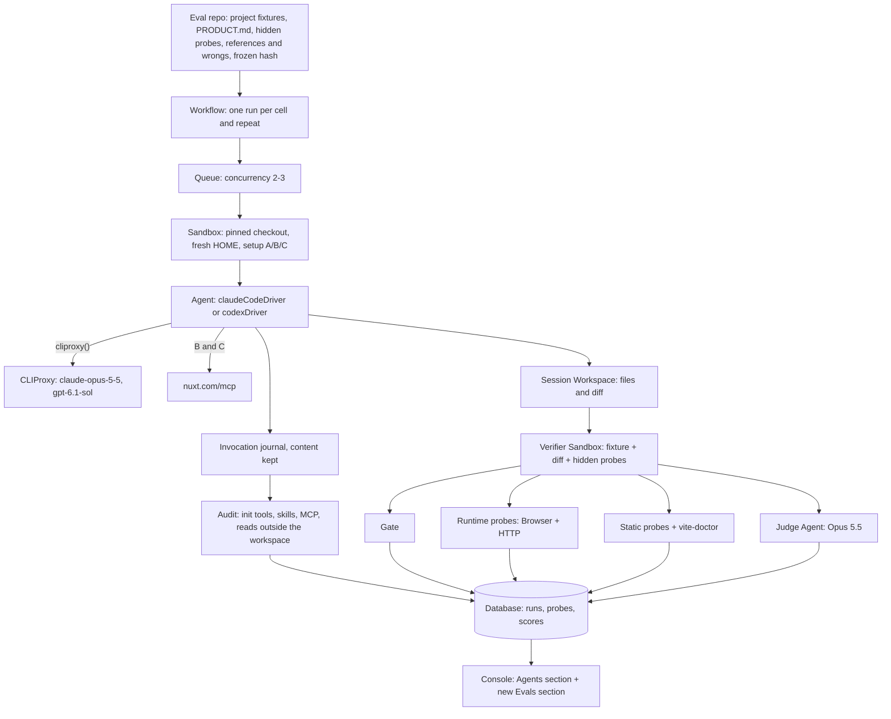

# Nuxt agent tooling evals on ViteHub

**The ocean:** a reproducible eval suite on ViteHub primitives. It measures whether the Nuxt MCP, the core Nuxt skills and the full nuxt-skills plugin make Claude Opus 5.5 (Claude Code) and Sol 6.1 (Codex) write *better* Nuxt 5 / Nitro v3 / h3 v2 code than a bare setup. The tasks are realistic, multi-feature projects that are hard enough to fail. The ViteHub Console shows every run, its transcript, the files the agent wrote, and the scores. It is internal first and public later.

> [!IMPORTANT]
> **What changed in v2 (from your comments):**
> - **Projects, not small tasks.** One big project with 8 features first, a second held-out project after it, then more. About 48 runs in the first round, not 750.
> - **Outcome first.** We grade what the app does at runtime and whether the code makes sense. Several correct styles pass. File layout and data flow are not graded. Tool use is a diagnostic, not a score.
> - **Harder.** We aim for a bare probe pass rate of 20–40% on project 1.
> - **Judge is Opus 5.5 only.** It scores code quality: abstraction, size, structure, idioms.
> - **Open web, no setup D, no outside reviewers, no nuxt.com/evals export, Nuxt MCP left as is.**
> - **Isolation through ViteHub primitives**, checked after each run. A leak is fixed in ViteHub (`pnpm patch`, then upstream), not with guardrail code in the eval.
> - **Console:** open mode with read-only grants already exists on main. The real gap is an **Evals section** that shows the score matrix.

## 1. Research findings (short)

v1 has the full tables. What still drives the design:

- **nuxt.com/evals is saturated.** Opus 5.5 scores 100% pass@4 there, because the tasks are small, pre-cutoff and graded by regex.
- **Single runs mislead.** Laravel Boost saw 7/19 become 17/19 just by running again. We run each cell k times and report the spread.
- **Tools are often not used.** In Vercel's runs the skill was not invoked 56% of the time. Nolan Lawson saw the Nuxt MCP used 0 times in 5 runs. We log usage, but we score only the output.
- **Circular rubrics.** Laravel's judge rubric came from their own skill. Our probes cite Nuxt docs pages, never a skill.
- **Skills under test** are [onmax/nuxt-skills](https://github.com/onmax/nuxt-skills): `nuxt`, `nitro`, `vue`, `pinia`, `nuxt-ui`, `nuxt-content`, `nuxthub`, `nuxt-i18n`, `nuxt-better-auth`, `nuxt-seo` and others. They have some Nuxt 4 habits and two factual errors (v1 §1). We fix them in a custom version inside the eval repo and release it later in nuxt-skills.

## 2. Walls (updated)

| Reason it "can't" work | Mark | v2 decision |
| --- | --- | --- |
| "Models do fine" | Habit, testable | Project 1 is built to be hard. If bare still scores above 60% on project 1, we make it harder before any headline run. |
| Quota | Not a wall now | Your CLIProxy, no quota. We still measure tokens per run in the smoke step before we scale. |
| Bare isn't bare | Real, handled in ViteHub | Configure HOME, skills and MCP through the Agent and Sandbox primitives. An audit after every run reads the transcript's init event and tool calls. A run that fails the audit is invalid and not scored. A leak is fixed in ViteHub. |
| Many correct answers | Real, handled in grading | Runtime probes test behavior. Static probes accept a *family* of correct forms. Each probe must pass two reference solutions in different styles. |
| Maxi writes tasks, probes and skills | Real (credibility) | Freeze and hash project 2 and its probes before any skill edit and before any agent run. Project 1 is the dev set: we may tune skills against it. Headline numbers come from project 2. |
| Tuning difficulty on bare results biases B − A | Real | We harden project 1 only, and only before the skill edits. We never tune project 2. |
| Judge is Opus, and Opus is under test | Real, bounded | The judge compares setups *within one agent*, so Opus's preference for its own style is the same for A, B and C. Comparisons across agents carry a note. You label ~20 pairs to calibrate. |
| Nuxt 5 is nightly only | Real, managed | Pin one nightly, Nitro rc, h3 and module versions in the lockfile, and show them on every result. |
| Slimbook is shared | Real | Agent runs are mostly network wait. Verifier builds and Chromium go through `heavy`. Concurrency is 2–3. |

## 3. Grading

Each run is graded in a **separate verifier Sandbox**: the pristine fixture plus the agent's diff plus hidden files. The agent never sees the probes.

**Rules for a fair probe:**
- Test outcomes, not names or file paths. The agent can put code where it wants.
- A static probe accepts a family. Example: "server input is validated with a schema before use" passes with `readValidatedBody`, `getValidatedQuery`, or `schema.parse()` on `readBody()`. The runtime probe "bad input returns 400 with field errors" is the hard part. The judge notes the more idiomatic form, but the probe does not fail on it.
- Each probe cites a Nuxt, Nitro, h3 or Vue docs page.
- Each probe passes two reference solutions written in different styles, and fails at least one tempting-wrong solution. Same result in 3 reruns. A probe that can't do that moves to the judge rubric or is dropped.

| Layer | What | How | Weight |
| --- | --- | --- | --- |
| Gate | The app builds and the features work | `nuxt build`, hidden behavior tests over HTTP and Playwright | Reported as its own rate. The other layers score only builds that pass. |
| Runtime probes | The structure pays off | Playwright and HTTP on the prod build: hydration warnings (browser and server in different time zones), client API calls on first load, requests per interaction, `__NUXT_DATA__` bytes, route JS bytes, state leak with two concurrent users, status codes, upstream and mailer call counts, response time, secret not in client output | 40% |
| Static probes | The right primitive family | AST probes plus vite-doctor JSON. New vite-doctor findings compared with the fixture count as a penalty. | 25% |
| Judge (Opus 5.5) | Does the code make sense | A rubric scored 1–5 with anchors: **abstraction** (reuses existing utils, one shared schema or type for app and server, a composable where logic repeats), **size** (lines added compared with the reference, dead code, over-engineering), **structure** (server/client boundaries, clear ownership), **idioms** (Nuxt 5 / h3 v2 docs), **readability**. Plus a blind pairwise comparison inside one agent (A vs B, B vs C) with the order swapped. | 35% |
| Diagnostics | How it got there | Nuxt MCP calls, skill reads, web fetches and their URLs, tokens, turns, time, lines added, files touched | Not scored |

**Headline numbers per cell (agent × setup):** the median quality score with its IQR over k runs, the probe pass rate, and the gate rate. Comparisons B − A and C − B are paired by probe. Each comparison is shown for all runs and for runs where the tool was used.

## 4. Architecture on ViteHub

- **Host:** one Node ViteHub app on Slimbook: OpenWorkflow on SQLite, local Queue, fs Blob, SQLite Database. It runs wherever the Sandbox runtime works; the location is not a decision.
- **Setups:**
  - **A, bare:** no MCP servers, no skills. Web allowed.
  - **B:** Nuxt MCP plus the core skills `nuxt` and `nitro` from nuxt-skills.
  - **C:** the full nuxt-skills plugin, installed the way a normal user installs it.
- **Repo:** a private eval repo for now. It depends on published ViteHub packages. Fixes to ViteHub go in as `pnpm patch` first, then as upstream PRs, one concern each.
- **Isolation:** configured only through the Agent and Sandbox options. No custom guardrail layer. The audit after each run is the proof. The ViteHub driver's own loopback MCP server is the same in A, B and C, so it is fair if it adds no Nuxt knowledge. The audit checks that.

## 5. Projects

### Project 1 (dev set): Meetups

**The fixture is a partly built Nuxt 5 app** with:
- `@nuxt/ui`
- an in-memory repository of 2,000 events, with large objects: description, attendees and history
- an existing `getSessionUser(event)` helper
- a slow, paid exchange-rate service that needs an API key and counts its hits
- a slow mailer (1.5 s) that counts its sends
- a heavy chart package

The agent gets one `PRODUCT.md` with 8 features. It never names a primitive.

| # | Feature (product words) | What the probes check (any correct form passes) |
| --- | --- | --- |
| F1 | Event list with search, city filter and pages in the URL; Back and Forward work | Results in the SSR HTML. 0 client API calls on first load. 1 request per filter change. Payload under budget: the list shows only title, date, city and seats left. |
| F2 | Event page with good link previews; unknown events show a real not-found page | Title, description and OG tags in the SSR HTML. Status 404 for an unknown slug. |
| F3 | "Starts in 3 hours" and the local date on list and page | 0 hydration warnings when the browser and the server are in different time zones. |
| F4 | RSVP form with the same rules on client and server (name, email, 1–4 seats) | Bad POST returns 400 with field errors. The rules are defined once and used by both sides. |
| F5 | "Seats left" in the header and on the page, updated after an RSVP without reloading the list; "My RSVPs" count per user | No state leak between two concurrent users. No full-list refetch after an RSVP. |
| F6 | Confirmation email after an RSVP | The RSVP responds in under 500 ms, and exactly one mail is sent. |
| F7 | Ticket price in the visitor's currency through the paid API | The key is not in the client bundle or the payload. The upstream is called at most once in 10 minutes over 50 requests. The key can be changed at runtime through env. |
| F8 | Organizer dashboard with attendees and a chart, for organizers only | An anonymous visit gets a server redirect, with no client flash. The dashboard API returns 401/403. The code reuses `getSessionUser`. The chart JS is not in the `/events` bundle. |

This gives about 25 probes. Hydration, payload, shared code (`shared/` or an equivalent single source), Nuxt state and the server/client boundary are all in it.

### Project 2 (held out): written and frozen before any agent run

A different domain with more modules, for example a docs site with a blog and i18n (`@nuxt/content` v3, `@nuxtjs/i18n`), or a shop on NuxtHub. Same probe rules. It is used only for the headline numbers, and nobody looks at its runs while the skills change.

### Later projects

One project per gap that the first two show, for example auth modules, Pinia-heavy state, or `@nuxt/scripts` as a control (no skill exists, so C should equal B).

## 6. Units of work (start small)

| # | Unit | Done when | Budget | Stop or fallback |
| --- | --- | --- | --- | --- |
| U1 | **Spike**: one trivial prompt per agent × setup, so 6 runs. Check that the Sandbox and Agent options give a clean setup; the audit sees tools, skills and MCP; the journal keeps the transcript; the Console shows the session Workspace files; `gpt-6.1-sol` works with the pinned Codex; vite-doctor runs on a nightly fixture; hydration warnings are visible in a prod build. | Each item answered with a log or a Console link | 4 h, 6 runs | A leak or a missing feature: `pnpm patch` it in ViteHub, then go on |
| U2 | Project 1 fixture, `PRODUCT.md`, probes, 2 references and the wrong solutions. Write project 2 the same way and freeze its hash. | References pass, wrongs fail, 3 stable reruns | 2 days | A probe that can't separate them goes to the judge or is dropped |
| U3 | **Smoke**: project 1, k = 1, so 6 runs | Grader works on real output; tokens and time per run known | 6 runs | Fix only the grader here, not the project |
| U4 | Difficulty check | Bare probe pass rate is 20–40% | – | Above 60%: harden project 1 and repeat U3 |
| U5 | Skills: custom nuxt-skills version for Nuxt 5 / Nitro v3 / h3 v2 in the eval repo. Fix the known errors, and fill the gaps that project 1 shows. | Leak check: no project-specific names in any skill | 1 day | – |
| U6 | Project 1, k = 3, so 18 runs | Spread per cell known | 18 runs | Spread too wide to read a difference: raise k only for project 2 |
| U7 | **Project 2, k = 3**, so 18 runs: the headline | B − A and C − B with intervals | 18 runs | Infra failure rate above 10%: stop and fix |
| U8 | Judge calibration: you label ~20 pairs | Agreement measured | 1 h of your time | Low agreement: lower the judge weight |
| U9 | Console: Evals section PR, then open read-only mode when we go public | Results readable in the Console | 1–2 days | – |
| U10 | More projects, one at a time | – | – | Only after U7 |

**First round total:** about 48 agent runs plus judge calls.

## 7. Console view

**Internal now, public later, with no custom build.**

What exists on main (`4763b4fba`, checked in the source):
- **Public read-only access is configuration, not a new primitive.** `console: { auth: false, authorize }` runs in production with a warning. `authorize` is called without a user and can return `{ sections: ['agents:read'] }`. A `:read` grant refuses every write operation.
- **The Agents section** shows sessions, the invocation timeline, tool calls and the session Workspace files (`file` in the URL).
- **The journal** keeps prompts and transcripts only with `content: 'content'`. The default is metadata only.

Gaps, as general ViteHub features that any app with agent evals can use:
1. **Evals section** (owner: `vite-hub/agent/eval`). It shows a matrix of scenario × variant × agent with scores, median and IQR, and each cell links to its Agents session. Today eval results go to evalite only. This is the main gap.
2. **Session diff against the base revision.** Workspace history has revisions. U1 checks whether the session view shows a diff, or only files.
3. **Run history for Workflow and Queue.** The Console docs say there is none. The Agents session list serves as live progress for now.
4. **Redaction check.** U1 checks that the Agents section in open mode shows no gateway headers, env or host paths in the captured setup.

## 8. Decisions recorded

| Question | Decision |
| --- | --- |
| Quota | Your CLIProxy, no quota. Start small. |
| Judge | Opus 5.5 only |
| Web | Open for all setups; web use is logged |
| Setup D (AGENTS.md index) | Not now |
| Isolation | ViteHub primitives plus an audit after each run; fix leaks in ViteHub |
| Official skills | onmax/nuxt-skills, with a custom Nuxt 5 version released later |
| Nuxt MCP 4.x default | Leave it |
| Held-out authors | Us; share results later |
| Output | Console only; no nuxt.com/evals export |

**Still open:**
- When you write "let's start now", do you mean to start U1? The brief for this doc said plan only, so nothing has run.
- Should the domain of project 2 be content + i18n or a NuxtHub shop?
